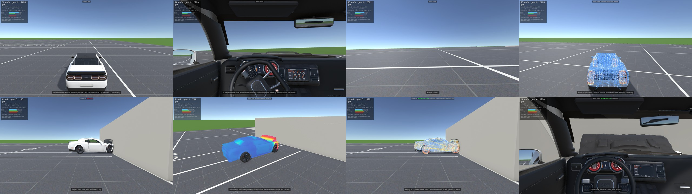
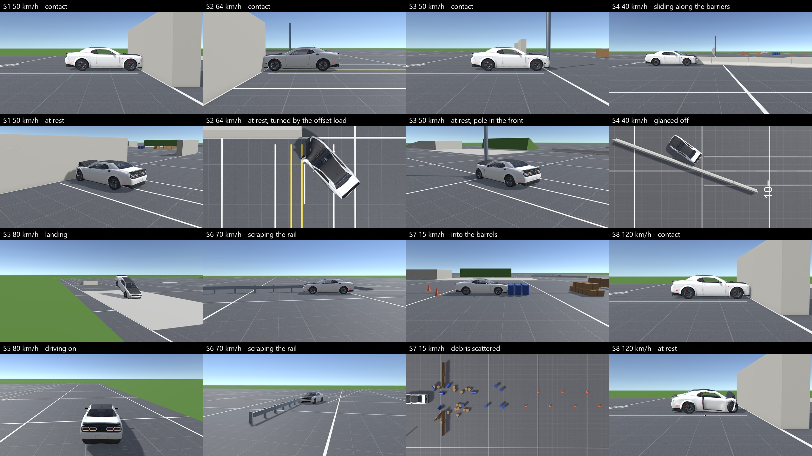

# Hellcat Sandbox — Dodge Challenger Hellcat crash sandbox



A playable sandbox: drive a **Dodge Challenger SRT Hellcat Widebody** around a test ground and crash it into obstacles.
The damage is **not an animation**: it is a real soft-body simulation (nodes and beams, BeamNG style) running at 2,000 steps per second.
The car dents, breaks and loses parts, depending on the speed and angle of the impact.

## How to run (5 minutes, nothing to install)

### 🪟 Windows 10 / 11

1. Download **[Play-Windows.bat](Play-Windows.bat)**: open it via the link and click **Download raw file** (the ⬇ icon in the top right).
2. Double-click the downloaded file.
3. If Windows says *"Windows protected your PC"*, click **More info → Run anyway**. This is normal: the file is not signed.
4. On the first start the file downloads the game (about 80 MB); wait a couple of minutes and the game opens.
   After that it starts instantly.

### 🍎 Mac (Apple Silicon recommended: M1 / M2 / M3 / M4)

The easiest way is one line in Terminal:

1. Open **Terminal** (Cmd + Space → type "Terminal" → Enter).
2. Paste this line and press Enter:

   ```bash
   bash <(curl -fsSL https://raw.githubusercontent.com/Prokopiy8247/Opus55-Dodge-Challenger-3DModel/main/Play-Mac.command)
   ```
3. On the first start the game downloads (about 80 MB) and opens by itself.

Another way: download **[Play-Mac.command](Play-Mac.command)**, then **right-click it → Open → Open**.
If it says "permission denied", run `chmod +x ~/Downloads/Play-Mac.command` in Terminal and open the file again.

> ⚠️ The Mac build comes from the same project, but the author could only test the game on Windows.
> If something does not work on Mac, please open an [Issue](../../issues) with your Mac model and the error text.

## Controls

| Key | Action |
|---|---|
| **W / S** | throttle / brake (hold S while stopped to reverse) |
| **A / D** | steering |
| **Space** | handbrake |
| **C** | camera: chase, bumper, **cockpit**, free |
| **Esc** | menu: **teleport to any obstacle** at a chosen speed |
| **R** | reset the car, undamaged, to the last safe spot |
| **Shift + R** | repair in place |
| **T** | slow motion (handy for watching the body crumple) |
| **N / H** | show the car's "skeleton" / stress map |
| **F5 / F6** | record a run / replay it (bit-exact replay) |

A gamepad works too. All keys: [docs/controls.md](docs/controls.md).

**Try this:** press **Esc**, pick "O1 — concrete wall", speed 56 km/h, and watch the impact
from different cameras, then press **T** (slow motion) and **Shift + H** (deformation map).

## Troubleshooting

| Problem | What to do |
|---|---|
| The game stutters, "SLOW-DOWN" in the corner | The CPU is too slow: the physics runs 2,000 times per second. Close the browser and other programs |
| The download did not start / an error | Check your internet connection and run the file again |
| The antivirus complains about the `.bat` | The file only downloads the archive from this repository and starts the game; you can open it in Notepad and read it |
| I want to uninstall the game | Delete the `HellcatSandbox` folder in your home folder (`C:\Users\<user>\HellcatSandbox` / `~/HellcatSandbox`) |

Requirements: Windows 10/11 64-bit with a DirectX 12 graphics card (or a Mac with Metal), a CPU with 6+ cores, 8 GB RAM.

## For developers

Blender (model and skeleton) → Unity 6000.6 (a custom physics solver on Burst/Jobs). Everything is reproducible:
see **[docs/README.md](docs/README.md)** for building from source, physics tuning, tests and quality gates;
phase reports are in `docs/P0_report.md … P7_report.md`, design decisions in `docs/decisions.md`.
Reference photos and heavy videos are not part of the repository.

### Connect Claude Code or Codex to Blender

**[Blender_MCP_Guide.pdf](Blender_MCP_Guide.pdf)** is a short step-by-step guide: one Unity project, one Blender file
and Blender MCP on one port, connected to Claude Code or Codex (Desktop or VS Code), with an example first prompt.


