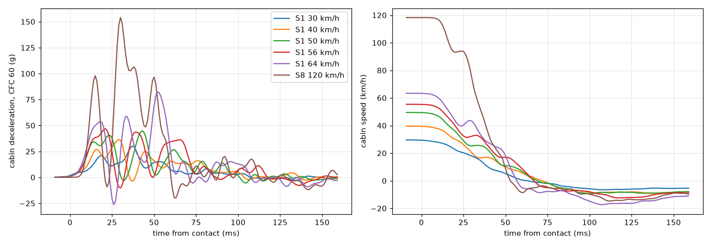
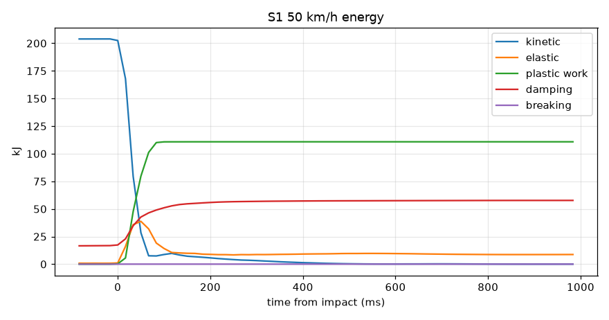
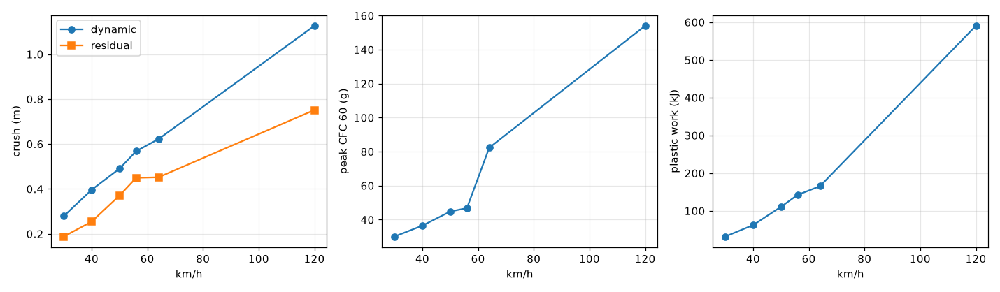

# P4 report: skinning in Unity and the first scripted crash (S1)

Gate G-Crash: **PASS** (0 FAIL, 0 WARN, 22 checks, `docs/gates/gate_p4.md`).
The Blender model is exported per part group and skinned in Unity to the 2,107 skeleton nodes (572,039 vertices,
165 objects, worst bind error 0.0005 mm). The scripted frontal crash S1 into the rigid wall O1
at 50 km/h crumples the bumper, the hood and the front rails and leaves the cabin intact: dynamic crush
0.49 m (residual 0.37 m), cabin pulse 70 ms with a 45 g CFC 60 peak
(20 g mean), rebound 2.6 m/s, 34 broken beams, 111 kJ of plastic work, the headlamps torn off,
no energy created, no node through the wall. Damage grows with speed over 30 / 40 / 50 / 56 / 64 km/h and the 120 km/h
end point (S8). Videos and stills: `docs/video_assets/P4/`; decisions D-055 ... D-068 in `docs/decisions.md`. Found on the
way and open for P4b: a slow straight-line instability over minutes of driving (D-067), which keeps gate P3b at one
failing check (T12's top-speed path offset).

## What was built

- **Export (brief 7):** `tools/export_all.py` runs Blender in the background (`--factory-startup`) on the latest working
  file and writes one FBX per skeleton part group (32 files: body, doors, hood, deck lid, bumpers, fenders, glass,
  wheels, running gear, interior, seats, radiator, detachable lamps and mirrors), `parts.json`, `materials.json` and the
  textures to `Unity/HellcatSandbox/Assets/Game/Vehicles/Hellcat/Export`.
- **Binding:** `Tools/Hellcat/Import Car` (`CarImporter`, batch `ImportBatch`) binds every vertex to up to 4 nodes of its
  own part (inverse-distance weights; the interior trim to the passenger cell's cage with smoother weights, D-068), writes
  the compact `*.skin.bytes` next to every FBX and the prefab
  `Hellcat.prefab` (one bone per node, GPU skinning, `updateWhenOffscreen`). At the model pose the skinned meshes
  reproduce the originals within 0.0005 mm (CH_Spoiler); farthest bound node
  0.64 m (CH_Int_Seat_Rear). Report: `docs/p4/import_report.json`.
- **Node frames (D-062):** every node bone takes the best-fit rotation of its neighbourhood (Horn's quaternion method,
  warm-started), not a Gram-Schmidt frame from two neighbours: those flipped by up to 175 deg in a crush. The bind pose
  is a pure translation, so the frames are the identity at rest.
- **Detached parts:** the lamps, mirrors, radiator, fuel tank and seats are parts of their own (D-058) and fly with their
  nodes once their mounts break; lamps, mirrors and radiator collide with the car's own triangles.
- **Glass (D-064):** a pre-fractured shard mesh per pane (Voronoi cells seeded at the pane's nodes, `hcar/glass_shards.py`,
  `3DDodgeChallenger_v011.blend`), each shard rigid on one node; the pane swaps to its shards when its glass beams break.
  Test (`-breakGlass 0.4` at 120 km/h): 6 of 6 panes shattered.
- **Crash player** (`Builds/P4_Crash/HellcatCrash.exe`, scene `P4_Crash`, `CarCrashScenario`, `CrashMetrics`,
  `SkinningProbe`): the settled car is driven along the lane at the target speed (speed and lane controllers, inputs
  recorded per frame) into the 12 x 3 x 1 m concrete wall, or launched rolling (S8); 4 cameras (chase, side, three-quarter from the left rear,
  top) captured at the end of every frame (after the GPU skinning); per run `sim/cache/<S>/<run>/`: result JSON, time
  series (energies, damage, inputs), 1 kHz cabin pulse, skinning log of the first 250 ms, stills, frames.
  `tools/p4/crash_series.ps1` runs the series, `tools/p4/pipeline.ps1` the whole chain after a change.
- **Solver and skeleton changes for crashes** (decisions D-055 ... D-063): hard contact with energy-correct projection,
  spring-back suppression, crush zones without rigidifiers, detachable assemblies with self-collision, hood latch,
  torsion-bar failure, pair impulse for node-triangle contact, and closure hinges / latches held in 3D.

## S1 at 50 km/h (baseline)

| quantity | value |
|---|---|
| speed at impact | 49.5 km/h |
| dynamic crush (cabin travel from the contact to the stop) / residual crush (car shortened, end of the run) | 0.490 m / 0.370 m |
| pulse duration, cabin deceleration peak CFC 60 / raw 4 ms / mean | 70 ms, 44.8 g / 45.8 g / 20.0 g |
| rebound speed of the cabin | 2.59 m/s |
| energy at the contact / created after it | 221.0 kJ / 0 J |
| at the end: plastic / damping / breaking / contact and friction | 110.8 / 57.9 / 0.03 / 43.3 kJ |
| broken / plastic beams, plastic shell hinges | 34 / 757, 334 |
| detached parts | headlight_L, headlight_R |
| damage | broken by material: lamp_mount 18, stop_closure 16 |
| closures | offsets from the cabin rigid motion (m): roof skin 0.037 (rise 0.034) door_FL 0.032 (rise 0.020) door_FR 0.032 (rise 0.017) hood 0.647 (rise 0.462) | door_FL: aperture 1.397 m changed by up to 8 mm, latch force up to 1.3 kN | door_FR: aperture 1.397 m changed by up to 8 mm, latch force up to 0.9 kN |
| hood rise / roof skin rise | 0.46 m / 0.034 m |
| colliding nodes past the wall face, non-finite nodes | 0, 0 |
| physics cost | 244 us per 0.5 ms substep (parallel solver), exact S 2.442 |

The front structure takes the energy: in the X21 diagnostic (same car, editor) the plastic work at the cabin stop is
almost entirely in the front (rails, crush braces, cans, aprons, core support); the cabin's share stays below 1 kJ. The
hood folds up into a tent while its latch holds; the doors stay latched and move with the body's elastic flex (a few
centimetres relative to the cabin's rigid motion during the pulse, back afterwards).

## Speed series: damage grows with the speed

| run | impact km/h | crush dynamic / residual m | pulse ms | peak g CFC 60 (raw 4 ms) | mean g | rebound m/s | broken / plastic beams | plastic kJ | detached | hood rise m | door offset m | energy created J | tunnelled |
|---|---|---|---|---|---|---|---|---|---|---|---|---|---|
| S1 30 km/h | 29.6 | 0.279 / 0.188 | 63 | 30.1 (33.0) | 13.2 | 1.82 | 33 / 406 | 32.1 | headlight_L, headlight_R | 0.40 | 0.024 | 0 | 0 |
| S1 40 km/h | 39.8 | 0.396 / 0.254 | 72 | 36.5 (41.5) | 15.5 | 2.56 | 34 / 598 | 62.5 | headlight_L, headlight_R | 0.46 | 0.033 | 0 | 0 |
| S1 50 km/h | 49.5 | 0.490 / 0.370 | 70 | 44.8 (45.8) | 20.0 | 2.59 | 34 / 757 | 110.8 | headlight_L, headlight_R | 0.46 | 0.032 | 0 | 0 |
| S1 56 km/h | 55.4 | 0.568 / 0.450 | 67 | 46.8 (50.0) | 23.4 | 3.45 | 47 / 823 | 142.5 | headlight_L, headlight_R | 0.48 | 0.034 | 0 | 0 |
| S1 64 km/h | 63.4 | 0.622 / 0.452 | 56 | 82.3 (86.8) | 31.5 | 4.83 | 52 / 1023 | 165.5 | headlight_L, headlight_R | 0.57 | 0.064 | 0 | 0 |
| S8 120 km/h | 118.3 | 1.127 / 0.751 | 54 | 154.0 (175.6) | 63.2 | 4.09 | 104 / 2228 | 590.4 | headlight_L, headlight_R, mirror_L, mirror_R | 0.64 | 0.196 | 0 | 0 |

Pulse: the cabin mass centre's speed at 1 kHz, deceleration filtered CFC 60 (SAE J211) in `tools/gate_p4.py`; the raw
4 ms value carries the structure's ringing. Door offset: the largest offset of a door node from the cabin's rigid motion.

## Why the solver changed (X21 crash diagnostic)

`X21` (`Assets/Sim/Validation/CrashDiagnostics.cs`, `-executeMethod ...ValidationTasks.RunDynamics -valTests X21`)
launches the settled car rolling into the wall in the editor with the production solver and full energy tracking, in
the final configuration and with single changes switched off; results `docs/p4/x21/`. The energy balance is kinetic +
gravity + elastic + torsion + pressure + driveline + damping + plastic + breaking: the wall and the ground are passive,
so it may only fall after the contact.

| variant (50 km/h unless named) | crush m | pulse ms | peak g 1 ms / 10 ms, mean | rebound m/s | KE after the stop kJ | energy created J | broken beams |
|---|---|---|---|---|---|---|---|
| S1 configuration | 0.669 | 83 | 43.9 / 36.6, 17.0 | 2.77 | 11.2 | 0 | 35 |
| without hard contact (D-055) | 0.680 | 84 | 40.2 / 37.3, 16.7 | 2.64 | 10.1 | 0 | 48 |
| without spring-back suppression (D-056) | 0.648 | 77 | 51.5 / 40.8, 18.3 | 5.28 | 35.8 | 0 | 37 |
| without self-collision of the detachables (D-058) | 0.667 | 81 | 44.0 / 36.6, 17.4 | 2.85 | 11.3 | 0 | 35 |
| configuration at 30 km/h | 0.435 | 84 | 32.2 / 24.1, 10.0 | 2.10 | 5.6 | 0 | 33 |
| configuration at 64 km/h | 0.763 | 65 | 78.2 / 61.7, 27.8 | 4.97 | 25.9 | 0 | 51 |
| configuration at 120 km/h | 1.113 | 52 | 180.7 / 125.2, 64.4 | 4.19 | 78.2 | 0 | 104 |

At the cabin stop (S1 configuration, kJ): kinetic 6.2, elastic 28.0, torsion 1.0, pressure 0.6, gravity -0.5, driveline 0.1, plastic 110.4, damping 33.2 | elastic front 24.1 / cabin 2.8 / rear 1.2 (yielded beams 4.2), plastic front 108.4 / cabin 0.1 / rear 0.0

History of the S1 configuration at 50 km/h (X21 runs of the same day, `docs/p4/x21/*.csv`): the P3 contact (penalty +
projection) stopped the car in 0.46 m with a 92 g peak while the energy balance rose by 156 kJ (D-055); with the hard
contact 0.45 m / 76 g / 47 ms and nothing created; without the rigidifiers in the crush zones 0.67 m / 38 g / 79 ms
(D-057), rebound 5.6 m/s; spring-back suppression and the structure damping brought the rebound to 2.8 m/s (D-056).

## Skinning validation

| run | largest node-frame turn per frame (node) | largest vertex move per frame (mesh) | vertex ahead of the fastest node (mesh) | cabin: largest turned-over area of a mesh (outside the pulse) | cabin: transient fold in the pulse | crush zones: largest turned-over area of a mesh | physics us / substep |
|---|---|---|---|---|---|---|---|
| S1 30 km/h | 50.9 deg (0290_bbF_f_C) | 286 mm (CH_Wheel_RR_Tire) | 44 mm (CH_Headlamp_Housing_R) | 9.2 cm2 (CH_FloorPan) | 9 cm2 (CH_FloorPan) | 129 cm2 (CH_Fender_L) | 268 |
| S1 40 km/h | 58.5 deg (0316_bbF_t76_L) | 392 mm (CH_Wheel_RR_Tire) | 77 mm (CH_Headlamp_Housing_L) | 9.2 cm2 (CH_FloorPan) | 15 cm2 (CH_Int_SteeringWheel) | 781 cm2 (CH_WheelLiners_L) | 254 |
| S1 50 km/h | 70.7 deg (0290_bbF_f_C) | 489 mm (CH_Wheel_RL_Tire) | 70 mm (CH_Headlamp_Housing_R) | 9.2 cm2 (CH_FloorPan) | 85 cm2 (CH_Int_Sill_L) | 1005 cm2 (CH_CoreSupport) | 244 |
| S1 56 km/h | 84.6 deg (0800_fender_L_6_2) | 570 mm (CH_Wheel_RR_Tire) | 104 mm (CH_Headlamp_Housing_R) | 9.2 cm2 (CH_FloorPan) | 23 cm2 (CH_Int_SteeringWheel) | 2070 cm2 (CH_CoreSupport) | 247 |
| S1 64 km/h | 94.7 deg (0266_frail4_2_R) | 628 mm (CH_Wheel_RR_Tire) | 95 mm (CH_Headlamp_Housing_L) | 9.4 cm2 (CH_Int_SteeringWheel) | 79 cm2 (CH_Int_Sill_R) | 2637 cm2 (CH_Subframe_Front) | 243 |
| S8 120 km/h | 144.2 deg (0267_frail4_3_R) | 1061 mm (CH_Wheel_FL_Tire) | 111 mm (CH_Mirror_Housing_R) | 125.9 cm2 (CH_Int_Sill_R) | 189 cm2 (CH_FloorPan) | 2400 cm2 (CH_CoreSupport) | 270 |

- **At rest:** the bound meshes reproduce the originals within 0.0005 mm (brief: 1 mm).
- **Spikes:** linear blend skinning keeps every vertex inside the rigid motions of its own bones, so a spike needs a bone
  whose frame jumps. The probe (`SkinningProbe`, the GPU skinning recomputed on the CPU for all 572,039 vertices every
  frame) reports the largest node-frame turn between two frames: below 120 deg for every node joined to the cabin in the
  S1 runs. At 120 km/h a front rail segment folds at 33 m/s closing speed and its frame turns 144 deg in one frame: a real fold
  (reported, not gated). The largest vertex move per frame (brief 7) is the tread of a spinning tire at speed (twice the
  car's speed at the top of the wheel); the excess of the fastest vertex over the fastest node of the same frame is
  largest on parts spinning free after they tore off (a lamp housing far from its three nodes), as rigid rotation
  gives.
- **Inversion:** a triangle is turned over when its normal opposes that of its rest shape carried by the blended
  skinning transform at its first vertex (what an undistorted triangle there would show); the probe sums the turned-over
  area per mesh, in the cabin (between the A-pillar base and the C pillar) and in the crush zones. Outside the impact
  pulse (before the contact and from 150 ms after it) no cabin mesh turns more than 25 cm2 (a 5 x 5 cm patch) over in the
  S1 runs. Within the pulse the sill trim folds briefly where the sill meets the hinge pillar (the structure there flexes
  elastically under the 40-50 g load; the trim is back in shape at the end and hidden behind the closed door); the
  interior binds to the cell's cage only, with smooth weights (1 / (d + 8 cm)); the crushed ends (core support, front subframe, fenders, wheel liners) fold
  over as real sheet metal does. (Shares of a mesh's area mislead on tiny meshes: one sliver of the tachometer needle
  is 10 % of it.)

## Evidence

- `docs/video_assets/P4/2026-10-13_P4_rest_front34.png`
- `docs/video_assets/P4/2026-10-13_P4_rest_rear34.png`
- `docs/video_assets/P4/2026-10-13_P4_rest_side.png`
- `docs/video_assets/P4/2026-10-13_P4_rest_top.png`
- `docs/video_assets/P4/2026-10-13_P4_rest_wheel_FR.png`
- `docs/video_assets/P4/2026-10-14_P4_S1_kmh50_at_impact_chase.png`
- `docs/video_assets/P4/2026-10-14_P4_S1_kmh50_at_impact_front34.png`
- `docs/video_assets/P4/2026-10-14_P4_S1_kmh50_at_impact_side.png`
- `docs/video_assets/P4/2026-10-14_P4_S1_kmh50_at_impact_top.png`
- `docs/video_assets/P4/2026-10-14_P4_S1_kmh50_final_chase.png`
- `docs/video_assets/P4/2026-10-14_P4_S1_kmh50_final_front34.png`
- `docs/video_assets/P4/2026-10-14_P4_S1_kmh50_final_side.png`
- `docs/video_assets/P4/2026-10-14_P4_S1_kmh50_final_top.png`
- `docs/video_assets/P4/2026-10-14_P4_S1_kmh50_grid.mp4`
- `docs/video_assets/P4/2026-10-14_P4_S1_kmh50_slowmo_grid.mp4`
- `docs/video_assets/P4/2026-10-14_P4_S1_kmh56_at_impact_chase.png`
- `docs/video_assets/P4/2026-10-14_P4_S1_kmh56_at_impact_front34.png`
- `docs/video_assets/P4/2026-10-14_P4_S1_kmh56_at_impact_side.png`
- `docs/video_assets/P4/2026-10-14_P4_S1_kmh56_at_impact_top.png`
- `docs/video_assets/P4/2026-10-14_P4_S1_kmh56_final_chase.png`
- `docs/video_assets/P4/2026-10-14_P4_S1_kmh56_final_front34.png`
- `docs/video_assets/P4/2026-10-14_P4_S1_kmh56_final_side.png`
- `docs/video_assets/P4/2026-10-14_P4_S1_kmh56_final_top.png`
- `docs/video_assets/P4/2026-10-14_P4_S1_kmh56_grid.mp4`
- `docs/video_assets/P4/2026-10-14_P4_S1_kmh64_at_impact_chase.png`
- `docs/video_assets/P4/2026-10-14_P4_S1_kmh64_at_impact_front34.png`
- `docs/video_assets/P4/2026-10-14_P4_S1_kmh64_at_impact_side.png`
- `docs/video_assets/P4/2026-10-14_P4_S1_kmh64_at_impact_top.png`
- `docs/video_assets/P4/2026-10-14_P4_S1_kmh64_final_chase.png`
- `docs/video_assets/P4/2026-10-14_P4_S1_kmh64_final_front34.png`
- `docs/video_assets/P4/2026-10-14_P4_S1_kmh64_final_side.png`
- `docs/video_assets/P4/2026-10-14_P4_S1_kmh64_final_top.png`
- `docs/video_assets/P4/2026-10-14_P4_S1_kmh64_grid.mp4`
- `docs/video_assets/P4/2026-10-14_P4_S8_kmh120_at_impact_chase.png`
- `docs/video_assets/P4/2026-10-14_P4_S8_kmh120_at_impact_front34.png`
- `docs/video_assets/P4/2026-10-14_P4_S8_kmh120_at_impact_side.png`
- `docs/video_assets/P4/2026-10-14_P4_S8_kmh120_at_impact_top.png`
- `docs/video_assets/P4/2026-10-14_P4_S8_kmh120_final_chase.png`
- `docs/video_assets/P4/2026-10-14_P4_S8_kmh120_final_front34.png`
- `docs/video_assets/P4/2026-10-14_P4_S8_kmh120_final_side.png`
- `docs/video_assets/P4/2026-10-14_P4_S8_kmh120_final_top.png`
- `docs/video_assets/P4/2026-10-14_P4_S8_kmh120_glasstest_at_impact_chase.png`
- `docs/video_assets/P4/2026-10-14_P4_S8_kmh120_glasstest_at_impact_front34.png`
- `docs/video_assets/P4/2026-10-14_P4_S8_kmh120_glasstest_at_impact_side.png`
- `docs/video_assets/P4/2026-10-14_P4_S8_kmh120_glasstest_at_impact_top.png`
- `docs/video_assets/P4/2026-10-14_P4_S8_kmh120_glasstest_final_chase.png`
- `docs/video_assets/P4/2026-10-14_P4_S8_kmh120_glasstest_final_front34.png`
- `docs/video_assets/P4/2026-10-14_P4_S8_kmh120_glasstest_final_side.png`
- `docs/video_assets/P4/2026-10-14_P4_S8_kmh120_glasstest_final_top.png`
- `docs/video_assets/P4/2026-10-14_P4_S8_kmh120_glasstest_grid.mp4`
- `docs/video_assets/P4/2026-10-14_P4_S8_kmh120_grid.mp4`
- `docs/video_assets/P4/2026-10-14_P4_speed_series.jpg`

## Gate G-Crash

| # | check | status | detail |
|---|---|---|---|
| 1 | metrics table for every run (brief 9: deceleration, crush, broken beams, detached parts, energies) | PASS | 6 runs -> docs\p4\crash_metrics.csv |
| 2 | damage monotonic in speed: dynamic_crush_m (increasing) | PASS | 30 km/h 0.279, 40 km/h 0.3962, 50 km/h 0.4902, 56 km/h 0.5682, 64 km/h 0.622, 120 km/h 1.1267 |
| 3 | damage monotonic in speed: residual_crush_m (increasing) | PASS | 30 km/h 0.1881, 40 km/h 0.2543, 50 km/h 0.3703, 56 km/h 0.4496, 64 km/h 0.4519, 120 km/h 0.7515 |
| 4 | damage monotonic in speed: plastic_kJ (increasing) | PASS | 30 km/h 32.1, 40 km/h 62.5, 50 km/h 110.8, 56 km/h 142.5, 64 km/h 165.5, 120 km/h 590.4 |
| 5 | damage monotonic in speed: broken_beams (non-decreasing) | PASS | 30 km/h 33, 40 km/h 34, 50 km/h 34, 56 km/h 47, 64 km/h 52, 120 km/h 104 |
| 6 | detached parts non-decreasing in speed | PASS | 30 km/h 2 (headlight_L+headlight_R), 40 km/h 2 (headlight_L+headlight_R), 50 km/h 2 (headlight_L+headlight_R), 56 km/h 2 (headlight_L+headlight_R), 64 km/h 2 (headlight_L+headlight_R), 120 km/h 4 (headlight_L+headlight_R+mirror_L+mirror_R) |
| 7 | S1 50 km/h in the brief's sanity range (around 0.5-0.7 m crush, tens of g) | PASS | dynamic crush 0.490 m, residual 0.370 m, peak 44.8 g CFC 60 (45.76 g raw 4 ms), mean 20.0 g over 70.0 ms |
| 8 | S1 56 km/h in the brief's sanity range (around 0.5-0.7 m crush, tens of g) | PASS | dynamic crush 0.568 m, residual 0.450 m, peak 46.8 g CFC 60 (49.98 g raw 4 ms), mean 23.4 g over 67.0 ms |
| 9 | S1 50 km/h crumples bumper, hood and front rails but keeps the cabin intact (brief 9) | PASS | residual crush 0.370 m, hood buckled 0.46 m up, roof skin 0.034 m, door latches closed; plastic work front 108.4 / cabin 0.1 / rear 0.0 kJ (X21, 50 km/h) |
| 10 | closures (D-063): the doors stay latched in every S1 run; door offsets from the cabin's rigid motion reported | PASS | S1 30 km/h door 0.024 m / roof skin rise 0.024 m, S1 40 km/h door 0.033 m / roof skin rise 0.029 m, S1 50 km/h door 0.032 m / roof skin rise 0.034 m, S1 56 km/h door 0.034 m / roof skin rise 0.031 m, S1 64 km/h door 0.064 m / roof skin rise 0.037 m, S8 120 km/h door 0.196 m / roof skin rise 0.094 m |
| 11 | S8 120 km/h clearly more severe than S1 50 km/h | PASS | plastic 590.4 vs 110.8 kJ, crush 1.13 vs 0.49 m, detached headlight_L+headlight_R+mirror_L+mirror_R |
| 12 | no energy created after the contact (kinetic + stored + dissipated never rises; wall and ground passive) | PASS | 30 km/h 0.0 J, 40 km/h 0.0 J, 50 km/h 0.0 J, 56 km/h 0.0 J, 64 km/h 0.0 J, 120 km/h 0.0 J |
| 13 | no tunnelling: no colliding node past the wall face at any frame, no non-finite node | PASS | 0 at every speed (30-120 km/h) |
| 14 | X21 solver diagnostic present (contact and structure variants, energy balance) | PASS | S1 configuration created 0 J; without D-055 0 J; without D-056 rebound 5.279979762710456 m/s |
| 15 | at rest the skinned meshes reproduce the originals within 1 mm (bind pose, every vertex) | PASS | 165 objects, 572,039 vertices: worst bind error 0.0005 mm (CH_Spoiler), axis error 0.0002 mm |
| 16 | no spikes (S1): linear blend skinning keeps every vertex inside the rigid motions of its bones, so a spike needs a bone frame that flips - no node frame joined to the cabin turns more than 120 deg between two frames (60 fps) | PASS | S1 30 km/h 50.9 deg (0290_bbF_f_C), S1 40 km/h 58.5 deg (0316_bbF_t76_L), S1 50 km/h 70.7 deg (0290_bbF_f_C), S1 56 km/h 84.6 deg (0800_fender_L_6_2), S1 64 km/h 94.7 deg (0266_frail4_2_R), S8 120 km/h 144.2 deg (0267_frail4_3_R) (S8 for reference: a front rail folding at 33 m/s) | largest vertex move per frame (brief 7): 30 km/h 286 mm, 40 km/h 392 mm, 50 km/h 489 mm, 56 km/h 570 mm, 64 km/h 628 mm, 120 km/h 1061 mm (the spinning tires at speed; see the report) |
| 17 | no mesh inversion in the cabin (S1): outside the impact pulse (before the contact and from 150 ms after it) no cabin mesh turns more than 25 cm2 (a 5 x 5 cm patch, about the smallest the cockpit camera resolves) over against its own blended skinning transform; transient trim folds in the pulse and the crushed ends reported | PASS | S1 30 km/h cabin 9.2 cm2 (CH_FloorPan), in the pulse 9 cm2 (CH_FloorPan), crush zones 129 cm2 (CH_Fender_L), S1 40 km/h cabin 9.2 cm2 (CH_FloorPan), in the pulse 15 cm2 (CH_Int_SteeringWheel), crush zones 781 cm2 (CH_WheelLiners_L), S1 50 km/h cabin 9.2 cm2 (CH_FloorPan), in the pulse 85 cm2 (CH_Int_Sill_L), crush zones 1005 cm2 (CH_CoreSupport), S1 56 km/h cabin 9.2 cm2 (CH_FloorPan), in the pulse 23 cm2 (CH_Int_SteeringWheel), crush zones 2070 cm2 (CH_CoreSupport), S1 64 km/h cabin 9.4 cm2 (CH_Int_SteeringWheel), in the pulse 79 cm2 (CH_Int_Sill_R), crush zones 2637 cm2 (CH_Subframe_Front), S8 120 km/h cabin 125.9 cm2 (CH_Int_Sill_R), in the pulse 189 cm2 (CH_FloorPan), crush zones 2400 cm2 (CH_CoreSupport) |
| 18 | at least 3 camera angles per run (brief 14) | PASS | cameras ['chase', 'front34', 'side', 'top']; 6 runs with frames |
| 19 | pre-fractured glass swaps in when the panes' glass beams break (brief 7) | PASS | 6 of 6 panes shattered in the -breakGlass test |
| 20 | physics time per substep within the 2 kHz real-time budget during the crashes | PASS | 243-270 us per substep (budget 500) |
| 21 | P4 report written | PASS | docs\P4_report.md |
| 22 | plots: crash pulses (CFC 60), damage vs speed, S1 energy | PASS | docs\p4\plots |

## Deviations and open items

- **Frames (brief 7: Gram-Schmidt frames from 3 nearest nodes):** replaced by best-fit frames of up to 8 neighbours
  (D-062); the Gram-Schmidt frames flipped in the crush.
- **Shards (brief 7: Cell Fracture):** a scripted Voronoi split seeded at the pane nodes (D-064) so every shard sits on
  one node and the build stays reproducible in background Blender.
- **Hood:** folds into a single tent 0.4-0.6 m high at 30-64 km/h (a single fold of a 1.4 m hood shortened by the
  crush); real hoods fold lower thanks to crease initiators. Candidate for P6 tuning (hood crease lines).
- **Body flex:** the closures move a few centimetres relative to the cabin's rigid motion during the pulse at 50-64
  km/h; the body stiffness is capped by the 2 kHz stability limit (D-040).
- **S8 at 120 km/h** is clearly more severe (crush 1.1 m, all front structure, lamps and mirrors off, cabin plastic
  work), but the glass does not break by itself (only in the swap test); the glass strength and the A-pillar load path
  are P6 items (scenario S8 acceptance).
- **Physics cost:** 243-270 us per substep in the crash runs, with the self-collision of the
  detachables (budget 500 us at 2 kHz); interactive performance is measured in P4b.
- **Long-run straight-line stability (open defect, D-067, first task of P4b):** the P3b tests drive straight for 15-45 s.
  Diagnostic X24 (`-valTests X24`, `-valQuick 1` for the 120 s runs) found a slow directional instability: with the
  steering held at zero the car turns +4 deg in 60 s at a 150 km/h cruise and spins at about 90 s; at full throttle the
  robot loses the line after about 75 s (with the P3b skeleton and parameters too, so not a P4 regression). The
  road-wheel angles wander by tenths of a degree over 20-30 s (under drive the rear toe goes from 0.13 deg toe-in to 0.6
  deg toe-out); no plastic flow or rest-length change is involved. Its onset makes T12's top-speed path offset 0.505 m
  against the 0.5 m limit, so gate P3b fails on that one check until the fix. The crash scenarios (5 s runs with a lane
  controller) are not affected.
