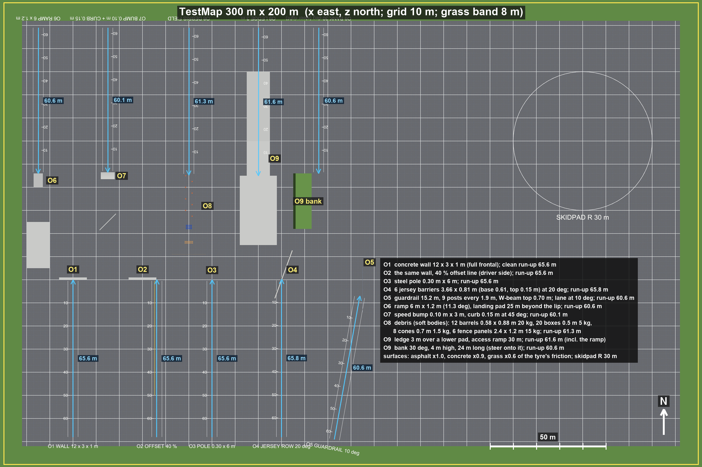

# P5 report: the test map

Gate G-Map: **PASS** (0 FAIL, 0 WARN, 26 checks, `docs/gates/gate_p5.md`).

**What the map is.** The test map of brief 8 is built in Unity by code (`TestMapBuilder`, scene `Assets/Scenes/TestMap.unity`, player `Builds/TestMap/HellcatTestMap.exe`).

- A 300 m x 200 m asphalt proving ground with 10 m marks and an 8 m grass band round the edge.
- The nine obstacles O1-O9, each with a painted lane and at least 60 m of clean run-up from its spawn point (60.1-65.8 m).
- A 30 m skidpad circle in the open east part.

**Debris.** The O8 debris (12 barrels, 20 boxes, 8 cones, 6 fence panels) consists of soft bodies in the same solver as the car (D-081). It collides with the car both ways and with the statics.

With 46 debris bodies in the world:

- the solver's exact stability criterion stays at the car's S = 2.442 (limit 2.5);
- the debris rests within 3.7 cm and 0.055 m/s;
- physics costs 349.4 us per 0.5 ms substep, within the 500 us real-time budget.

**The map check** runs one drive per lane in the player, using the teleport speed hold (D-080, D-083).

- **Walls, pole and barriers.** The car meets them at the target speed.
- **Debris.** The car scatters 32 debris bodies.
- **Ramp and ledge.** The car flies 0.823 s off the ramp and 0.8 s off the 3 m ledge, and lands upright.
- **Bump and curb.** At 30 and 50 km/h they leave no structural damage. Brief 9 says the car must not self-destruct over curbs and bumps at 30-50 km/h.
- **Solver health.** No node ends up inside an obstacle and no value is non-finite.

Decisions D-081 ... D-083 are in `docs/decisions.md`.

## Layout

10 obstacle entries, extent 300 x 200 m (`docs/p5/map_layout.json`).

- **Rows.** South row, lanes heading north: O1-O5. North row, lanes heading south: O6-O9. The obstacles face each other across a free strip, so a car that carries on after an obstacle passes between the other row's obstacles.
- **Surfaces.** Asphalt x1.0, concrete x0.9, grass x0.6 of the tyre friction. With the car this gives about 0.94 / 0.85 / 0.57 g: the skidpad measures 0.94 g on asphalt and the tyre's peak coefficient is 1.20 (T9). The brief asks for about 0.9 / 0.8 / 0.6.

| obstacle | build | brief |
|---|---|---|
| O1 | concrete wall 12 x 3 x 1 m, face at z = -20 | 12 x 3 x 1 m |
| O2 | the same wall; yellow lines for the wall edge and the 40 % overlap of the car's width on the driver side | 40 % overlap line |
| O3 | steel pole 0.30 m x 6 m | 0.30 x 6 m |
| O4 | 6 F-shape jersey barriers 3.66 m x 0.81 m (base 0.61, break 0.25 m wide at 0.33 m, top 0.15 m) end to end at 20 deg to the lane | 6 units, ~3.66 x 0.81 m, at 20 deg |
| O5 | guardrail 15.2 m, 9 posts every 1.9 m, W-beam 0.31 m with its top at 0.70 m, turned-down end; the lane meets it at 10 deg | ~15 m, posts 1.9 m, ~0.7 m |
| O6 | concrete ramp 6 m x 1.2 m (11.3 deg), 4 m wide; landing pad 10 x 20 m centred 25 m beyond the lip | 6 m x 1.2 m, landing 25 m beyond |
| O7 | speed bump 0.10 m high, 3 m long (circular arc), 6 m wide; curb 0.15 m x 0.3 m x 10 m at 45 deg to the lane, 20 m after the bump | curb 0.15 m, bump 0.10 x 3 m |
| O8 | 8 cones in gates, 12 barrels (4 x 3), 20 boxes (12 on the ground, 8 stacked), 6 fence panels across the lane, as soft bodies | 12 / 20 / 8 / 6 with the brief's sizes and masses |
| O9 | 30 m access ramp to a 10 x 15 m plateau, 3 m ledge over a 16 x 30 m lower pad; a separate 30 deg grass bank 4 m high, 24 m long beside its own lane | 3 m ledge with lower pad, 30 deg bank |

| lane | spawn (x, z) | heading deg | clean run-up m | default km/h |
|---|---|---|---|---|
| O1 | (-120, -88) | 0 | 65.59 | 50 |
| O2 | (-83.801, -88) | 0 | 65.59 | 64 |
| O3 | (-60, -88) | 0 | 65.59 | 50 |
| O4 | (-30, -88) | 0 | 65.832 | 40 |
| O5 | (-7.14, -89.043) | 10 | 60.59 | 70 |
| O6 | (-135, 89) | 180 | 60.59 | 80 |
| O7 | (-105, 89) | 180 | 60.09 | 30 |
| O8 | (-70, 89) | 180 | 61.29 | 15 |
| O9 | (-40, 89) | 180 | 61.59 | 40 |
| O9b | (-14, 89) | 180 | 60.59 | 40 |

## Debris in the solver (D-081)

`PropFactory` (Sim) builds the bodies and `PropField` (Game) adds them to the world and draws them.

- **Barrel.** Two rings of 8 nodes and two end-cap centres, braced; 20 kg.
- **Box.** 8 corner nodes, every pair braced; 5 kg.
- **Cone.** Weighted base corners, a foot ring and the tip; 1.5 kg.
- **Fence panel.** A 4 x 2 x 2 node board. Each end post is held by two buried fixed nodes in front of and behind it; the anchor beams break at 4 kN, after which the panel flies free.

Problems found and fixed on the way:

- **Stability.** S counts damping too (2 dt C / m), so the first rates took the world's S to 2.83. They are now sized per prop for about 0.6 (stiffness) + 0.3 (damping) + 0.7 (contact).
- **Spawn kick.** Props spawned on the ground sat inside the 10 mm contact zone and were kicked off. They now spawn 12 mm up.
- **Fence panels.** One anchor point per post let them tip over like inverted pendulums.
- **Box stacks.** Rotated stacks overhung their supporting corners and fell; the stacks are now aligned corner on corner.

Debris at rest after 5 s:

- fastest node 0.055 m/s;
- largest drift 3.7 cm;
- the fence panels still shiver a little (FencePanel 45: drift 0.037 m, node speed 0.031 m/s, height 0.64 m).

## Map check (player, `-scenario mapcheck`)

| lane | target km/h | at the obstacle km/h | hold | end km/h | broken beams (by material) | bent beams | airborne s | debris moved | deepest in obstacle mm |
|---|---|---|---|---|---|---|---|---|---|
| O1 | 30 | 30.0 | released 1.0 m before the obstacle | 1.3 | 33 (lamp_mount 18, stop_closure 15) | 419 | 0.0 | 0 | 0 |
| O2 | 30 | 30.0 | released 1.0 m before the obstacle | 0.4 | 23 (lamp_mount 9, stop_closure 14) | 383 | 0.0 | 0 | 0 |
| O3 | 30 | 30.0 | released 1.0 m before the obstacle | 3.0 | 15 (stop_closure 15) | 433 | 0.0 | 0 | 0 |
| O4 | 40 | 40.0 | released 1.0 m before the obstacle | 14.8 | 2 (subframe_mount 1, tierod 1) | 120 | 0.0 | 0 | 0 |
| O5 | 50 | 50.0 | released 1.0 m before the obstacle | 38.3 | 0 (-) | 37 | 0.0 | 0 | 0 |
| O6 | 60 | 59.8 | released 1.0 m before the obstacle | 36.9 | 11 (stop_closure 11) | 132 | 0.823 | 0 | 0 |
| O7 | 30 | 29.1 | run-up time over | 28.5 | 0 (-) | 0 | 0.0 | 0 | 0 |
| O7 | 50 | 50.5 | run-up time over | 48.7 | 1 (stop_closure 1) | 0 | 0.0 | 0 | 0 |
| O8 | 20 | 20.0 | run-up time over | 4.0 | 0 (-) | 74 | 0.0 | 32 | 0 |
| O9 | 30 | 35.1 | run-up time over | 29.1 | 9 (stop_closure 9) | 209 | 0.8 | 0 | 0 |

- **`stop_closure` beams.** These are the hood and deck-lid rubber stops. They release by design when a lid lifts off by half their length (D-034), so the jump and the 3 m drop shed some.
- **`lamp_mount` beams.** The headlamps detach in the frontal hits (D-058).
- **Bump and curb.** At 30 and 50 km/h they cost at most one released stop and no bent beam.

## Gate checks

| # | check | status | detail |
|---|---|---|---|
| 1 | map layout newer than the map builder | PASS | layout 2026-10-14 22:00:59, builder 2026-10-14 21:59:36 UTC |
| 2 | extent up to 300 x 200 m | PASS | 300 x 200 m, 10 m marks in the ground texture |
| 3 | O1: concrete wall, full frontal as specified | PASS | size [12, 3, 1] m (brief 12 x 3 x 1) |
| 4 | O2: concrete wall with 40 % offset line as specified | PASS | size [12, 3, 1] m, overlap line 40 % (brief: same wall, 40 % line) |
| 5 | O3: steel pole as specified | PASS | diameter 0.3 m x 6.0 m (brief 0.30 x 6 m) |
| 6 | O4: jersey barrier row as specified | PASS | 6 units 3.66 x 0.81 m at 20 deg (brief 6 x ~3.66 x 0.81 m at 20 deg) |
| 7 | O5: guardrail as specified | PASS | 15.2 m, posts every 1.9 m, W-beam top 0.705 m (brief ~15 m, 1.9 m, ~0.7 m) |
| 8 | O6: ramp and landing pad as specified | PASS | ramp 6.0 x 1.2 m, landing 25.0 m beyond (brief 6 x 1.2 m, 25 m) |
| 9 | O7: speed bump and curb as specified | PASS | curb 0.15 m, bump 0.1 x 3.0 m (brief 0.15 m; 0.10 x 3 m) |
| 10 | O8: debris field as specified | PASS | 12 barrels [0.58, 0.88] m 20 kg, 20 boxes 0.5 m 5 kg, 8 cones 0.7 m 1.5 kg, 6 fence panels; soft bodies in the car's solver (brief 12 / 20 / 8 / 6) |
| 11 | O9: 3 m ledge with lower pad as specified | PASS | ledge 3.0 m with a lower pad, bank 30 deg (brief 3 m ledge, 30 deg bank) |
| 12 | every obstacle lane has 60 m of clean run-up | PASS | 10 lanes, shortest 60.1 m |
| 13 | surfaces and friction documented | PASS | asphalt x1.0, concrete x0.9, grass x0.6 of the tyre friction (car on asphalt: skidpad 0.94 g, tyre peak 1.20: about 0.94 / 0.85 / 0.57 g; brief ~0.9 / 0.8 / 0.6) |
| 14 | map check newer than the map, debris and check sources | PASS | run 2026-10-14T22:03:52Z, newest PropFactory.cs 2026-10-14 22:00:38 UTC |
| 15 | solver stable with the debris in the world (S < 2.5) | PASS | exact S 2.4418 with 46 debris bodies (568 nodes) and the car; 2675 nodes, 13747 beams |
| 16 | debris at rest (no creep, no jitter) | PASS | after 5 s: fastest debris node 0.055 m/s, largest drift 3.7 cm, 0 moved > 5 cm |
| 17 | physics within the 2 kHz real-time budget with the debris | PASS | 349.4 us per 0.5 ms substep (solver only, player) |
| 18 | no tunnelling or non-finite values in any lane run | PASS | 10 runs; deepest node inside an obstacle 0 mm |
| 19 | teleport speed hold delivers V at the crash obstacles (D-080) | PASS | O1 30.0 km/h, O2 30.0 km/h, O3 30.0 km/h, O4 40.0 km/h, O5 50.0 km/h |
| 20 | the car meets every crash obstacle (damage recorded) | PASS | O1: 33 broken, 419 bent; O2: 23 broken, 383 bent; O3: 15 broken, 433 bent; O4: 2 broken, 120 bent; O5: 0 broken, 37 bent |
| 21 | curb and bump at 30 km/h without structural damage (brief 9) | PASS | over at 29.1 km/h, end 28.5 km/h, bent 0, broken: none (closure stops released by design, D-034) |
| 22 | curb and bump at 50 km/h without structural damage (brief 9) | PASS | over at 50.5 km/h, end 48.7 km/h, bent 0, broken: stop_closure 1 (closure stops released by design, D-034) |
| 23 | O6 ramp jump flies and lands upright | PASS | airborne 0.823 s, up 1.0, broken stop_closure 11 |
| 24 | O9 3 m drop flies and lands upright | PASS | airborne 0.8 s, up 1.0, broken stop_closure 9 |
| 25 | O8 debris scatters on impact | PASS | 32 props moved, car bent 74 beams |
| 26 | top-down and perspective screenshots with dimensions | PASS | annotated top-down, overview, 10 lane views captioned in map_lanes_sheet.jpg, 10 run views |

## Files

- **Images:**
  - `docs/p5/map_topdown_annotated.png`: top-down with the dimensions legend and the run-up lengths;
  - `docs/p5/mapcheck/map_topdown.png`: raw top-down at 10 px/m;
  - `docs/p5/mapcheck/map_overview.png`: perspective overview;
  - `docs/p5/map_lanes_sheet.jpg`: every lane in perspective with its dimensions;
  - `docs/p5/mapcheck/lane_*.png` and `run_*.png`.
- **Data:** `docs/p5/map_layout.json` (builder) and `docs/p5/mapcheck/mapcheck.json` (player).
- **Tools:** `tools/p5/annotate_map.py` and `tools/gate_p5.py`.

## Open points

- **Closure stops.** The hood and deck-lid stops release on hard landings (the jump, the drop); after that the lids can flutter. To review in P6 tuning: keep them, or raise their release length.
- **Frontal hits.** At 30 km/h into the wall both headlamps detach and the closure stops release (as at 50 km/h in P4). The crash series is re-run and tuned in P6.
- **Debris look.** Debris is drawn rigid: a barrel's dents and a broken fence's pieces do not show.
- **O9 bank.** The bank is for free driving; the scripted scenarios S1-S8 do not use O9.
