# Dynamics report (P3b, gate G-Dynamics)

Vehicle dynamics of the Hellcat on the production solver: validation tests 9-14 of brief section 10 (tires, suspension,
steering, powertrain, brakes, drive tests) and the driving acceptance targets of brief 4.13. Result of the run below:
**6/6 dynamics tests PASS** (2026-10-15T22:16:55Z), target table filled, plots in `docs/p3b/plots/`.
Gate: `tools/gate_p3b.py` (`docs/gates/gate_p3b.md`), targets `docs/p3b/targets_4_13.json`.

## How the tests run

`Hellcat.EditorTools.Validation.ValidationTasks.RunDynamics` (Unity batch via `tools/unity/run_unity_batch.ps1`) builds
every scenario as a `SoftBodyWorld` with the production solver (Burst jobs, dt = 0.5 ms, symplectic Euler) and writes
`docs/p3b/validation/dynamics_results.json` plus one CSV time series per scenario. T9 uses the tire rig (one wheel on a
drum, `TireTests`); T10-T14 drive the whole car with a driver robot (`DynamicsCommon.DriverRobot`: pure pursuit with a
look-ahead, a cross-track integral, yaw-rate damping, speed control, traction control on) on flat asphalt with the
obstacles built per scenario. The linear suspension tools (`tools/skeleton/elastokinematics.py`,
`tools/p3b/arb_tune.py`, `tools/p3b/front_struct_study*.py`) predict the compliances the tests then measure; the
diagnostics X9-X20 are only run when listed.

| Test | Scenario | Pass criteria |
|---|---|---|
| T9 | tire rig: static load vs deflection, inflation volume, free rolling, slip-angle sweep, longitudinal slip sweep, puncture | rate and hysteresis vs the measurements; mu-slip curve rises and saturates; puncture deflates |
| T10 | static corner loads and ride height, bounce (heave / front / rear), 50 mm step, 120 mm curb at 20 km/h, roll gradient, anti-roll-bar effect | loads within 5 % of the centre-of-mass split, total = m g; ride frequencies within the brief's +-15 %, zeta 0.21-0.56; no damage on step and curb; roll gradient 3.0 +- 15 % deg/g (suspension + tires); bars at least x1.5 |
| T11 | angle vs input on turntables, ratio, speed-sensitive reduction, return to centre | inner lock 32.5 +- 15 %, Ackermann positive, symmetry; 2.6 turns lock to lock; on-centre ratio 15 +- 20 %; the steering command follows the reduction curve within 2 %; back to centre in 0.6 s |
| T12 | idle, rev limit, gear ratios, 0-100 km/h, top-speed run, coast-down, engine braking, wheelspin | brief 4.13 bands (+-15 %); straight-line stability at top speed; the car spins its tires with TC off |
| T13 | 100-0 km/h with and without ABS, steering while braking, handbrake, repeated stops | 33-38 m +- 15 %; ABS shortens the stop; no lock-ups with ABS; rear-only handbrake; stops within 3 % |
| T14 | slalom, skidpad, figure eight, speed bump and curb, ramp jump | weaves through every gate at 50 km/h without sliding, settles on the run-out; skidpad 0.85-1.0 g +- 15 %; figure eight within 1.5 m, no spin; no damage on bumps and curbs; the jump lands with the running gear intact and the tires pressurized |

## Driving targets (brief 4.13)

| Target | Brief | Measured | Verdict |
|---|---|---|---|
| 0-100 km/h | 3.5-4.0 s (band 2.975-4.6 s) | 3.945 s | PASS - 1-ft rollout like the published figures; 4.31 s from the throttle application |
| top speed | 290-320 km/h (stock ~314) (band 246.5-368 km/h) | 282.5 km/h | PASS - asymptote of the acceleration vs speed of a full-throttle run from 270 km/h |
| 100-0 km/h braking | 33-38 m (band 28.05-43.7 m) | 33.47 m | PASS - ABS on, asphalt |
| skidpad | 0.85-1.0 g (band 0.7225-1.15 g) | 0.943 g | PASS - R 45.7 m (300 ft), highest 2 s mean a_y on the circle without sliding |
| weight transfer | visible dive, squat, roll (band -) | - | PASS - dive 3.9 deg (100-0 km/h), squat 2.1 deg (launch), roll gradient 3.19 deg/g |
| controllable | no self-oscillation, no flipping, recoverable slides, balance; easy wheelspin (band -) | - | PASS - T12 straight-line stability at top speed (robot steering): 0.681 deg/s; T12 open-loop straight line: 0.451 deg; T13 ABS keeps the car steerable: 4.39 ; T14 slalom: 0.989 deg; T14 slalom: 0.0454 m; T14 figure eight: 2.07 deg; T14 ramp jump: 0.465 deg; T14 ramp jump: 0.268 deg; T12 wheelspin on launch (traction control off): 6.08 ; understeer gradient 3.7 deg/g (understeer) |

## What the dynamics work changed

Decisions D-042 ... D-054 in `docs/decisions.md`; the P3b changes to the model and the tests:

- **Engine-mode driveline (D-042).** Torque-curve engine with inertia and engine braking, a torque converter with a
  lock-up clutch, the ZF 8HP90 ratios (S15) with a 2.62 final drive, an LSD and driveline compliance. 0-100 km/h
  3.92 s with the 1-ft rollout of the published figures.
- **Tire losses, hoop tension, inflation stiffness (D-043 ... D-045).** The carcass and rim damping is viscous with a
  velocity split; the belt ring carries a hoop tension proportional to omega^2; the carcass stiffness scales with the
  inflation. Fixed the wheel damp groups, which had swallowed the front knuckle's tie-rod end node and made the front
  wheels hop once per revolution at speed (D-046).
- **ABS and traction control (D-047)** as PI controllers on the slip speed with speed-scheduled targets.
- **Tire compound and contact friction (D-048).** A slow Stribeck decay (1.60 -> 0.75 over ~12 m/s), a friction
  ellipse with the lateral friction 0.88 of the longitudinal, and a stiffer tangential anchor; the tire's usable
  friction in the car then matches the rig.
- **Rear axle and alignment element (D-049).** Rear rail braces and a knuckle camber / toe spring-damper on the axle
  line (80 kN m/rad) that removed the compliance steer and camber that made the car weave at full throttle above
  200 km/h.
- **Front suspension package (D-051).** Tie-rod ends 40 mm outboard (Ackermann 52 % instead of -34 %), a K-member that
  ties the lower-arm pivots and the rack into one cradle, the front knuckle beams on their own stiffer material, the
  front anti-roll-bar links on the lower ball joints (the bar had worked at half its rate through the flat lower arm),
  torsion rates for the design bar contributions, and a front camber element measured against the steering axis.
  Front compliance steer 1.09 -> 0.38 deg/kN, lateral camber 0.92 -> 0.17 deg/kN.
- **Alignment reactions on the body frame (D-052).** The reaction of both elements goes to the four wind-up body sets
  that define the frame they are measured against, and the damping uses the frame's angular velocity, so the elements
  are conservative while the body deforms (E1 drift with damping off: 6 % -> 1e-5).
- **Steering damper and bar levers (D-054).** After the package the 0.2 m drop rang for 5.9 s: the front wheels yawed
  at 12 Hz on their stuck tire patches (the steering system against the tires' twist, with only the tie rods' 1.4 N m s/rad
  about the kingpin) and the bar's lever tips, moved outboard in D-051, swung fore-aft at 30 Hz. The front alignment
  element now also damps the steered knuckles' toe rate (20 N m s/rad, a power-steering gear's damping) and the tips are
  back at x 0.62: the drop settles in about 3.5 s again.
- **Test and robot procedures (D-050, D-053).** Gear-shift and lock-up logic in the stops and launches, the 1-ft
  rollout as the gate figure, the 95th percentile of the TC slip above 10 m/s; the curbs end outboard of the exhaust
  (they used to run under it), the roll gradient is compared with the design plus the tire compliance, the
  speed-sensitive reduction is measured on the command, the slalom is checked by whether the car reaches each gate,
  the ramp jump checks the running gear, and the robot's cross-track integral is an understeer correction that changes
  side with the turn.

## Findings and limitations

- **Long-run straight-line stability (found in P4, D-067; fixed in P4b, D-069).** The tests drive straight for 15-45 s.
  Diagnostic X24 (`-valTests X24`; `-valQuick 1` for the 120 s runs) showed a slow directional instability: with the
  steering held at zero the car turned about +4 deg in 60 s at a 150 km/h cruise and spun at about 90 s (with the P3b
  skeleton and parameters too). Cause: the wind-up angle (D-036) was integrated from the knuckle's and the body set's
  angular velocities and random-walked; its 200 kN m/rad torque turned the knuckles (toe). Anchored to the angle read
  from the pose (D-069) the car runs 120 s with the steering at zero within +-0.6 deg of heading (33 m off the line
  over 5 km) and T12's top-speed path offset fell from 0.505 to 0.21 m.
- **Top speed 283 km/h against the 314 km/h of the Widebody.** Under drive the node tire's losses reach about
  100 kW at 280 km/h (the tread nodes at 34 m/s carry a slip speed of 0.3-0.5 m/s against the Stribeck curve and the
  carcass hysteresis); the drag-limited asymptote of the acceleration-vs-speed fit is what T12 reports. A finer tire
  discretization or a loss compensation at the tread would close the gap (open question for the user).
- **Braking dive 3.9 deg and launch squat 2.1 deg** come from the springs alone (1.4 / 1.55 Hz, no anti-dive or
  anti-squat geometry); a real Hellcat has some (~30 %). The roll gradient is 3.19 deg/g against 3.0 predicted
  (suspension 2.3 + tires 0.7).
- **Front tire cornering stiffness is at the low end of the literature** (0.25 /deg against 0.3-0.4 for a 305/35 at
  5.4 kN); the understeer gradient on the circle is 3.7 deg/g, at the top of the passenger-car range but plausible
  for a 2,040 kg front-heavy RWD car with a 74 % front roll-stiffness share; the skidpad limit is 0.94 g (published
  Widebody tests 0.93-0.97 g).
- **Beam damping is viscous** while real bushings are hysteretic: local suspension modes in the 10-30 Hz range need
  explicit damping elements (the wind-up, alignment and steering dampers) rather than more beam damping, which the
  2 kHz stability limit caps (D-024).
- **The global body stiffness (7.2 kN m/deg torsion, 1.8 kN/mm bending) is below a real body's** - the 2 kHz stability
  limit at the modeled node masses (D-040). Under 1 g braking the front rails droop 6 mm relative to the cabin.

## Per-test results

### T9: Tire: load-deflection, pressure vs volume, free rolling, slip-angle and slip-ratio sweeps, puncture - PASS (9.7 s)

| Check | Value | Unit | Limit | Result |
|---|---|---|---|---|
| vertical tire rate at the rear corner load (4.3 kN): tangent | 390.7 | kN/m | deflection 13.7 mm, secant 314 kN/m | info |
| vertical tire rate at the front corner load (5.7 kN): tangent | 395 | kN/m | deflection 17.3 mm, secant 330 kN/m (progressive: the patch widens) | info |
| vertical rate at the front load (secant) vs the linear rate of the suspension design (292.9 kN/m, D-041) | 3.296e+05 | N/m | 2.929e+5 +- 20 % | PASS |
| vertical rate plausible for a 305/35 ZR20 at 241 kPa (tangent >= 220 kN/m) | 3.950e+05 | N/m | >= 2.2e+5 | PASS |
| vertical rate plausible (tangent <= 500 kN/m) | 3.950e+05 | N/m | <= 5e+5 | PASS |
| sealed cavity: p V = const (isothermal ideal gas) over the load cycle | 4.553e-08 |  | <= 1e-4 | PASS |
| cavity volume unloaded / at 5.7 kN | 52.49 | l | 52.01 l, gauge pressure 241.3 -> 244.4 kPa | info |
| inflated to 0 kPa: cavity volume / tread radius / rate at 4.3 kN | 52.48 | l | radius 352.7 mm, rate 71 kN/m, deflection 78.6 mm | info |
| inflated to 60 kPa: cavity volume / tread radius / rate at 4.3 kN | 52.49 | l | radius 352.7 mm, rate 249 kN/m, deflection 23.6 mm | info |
| inflated to 150 kPa: cavity volume / tread radius / rate at 4.3 kN | 52.49 | l | radius 352.7 mm, rate 300 kN/m, deflection 16.7 mm | info |
| inflated to 200 kPa: cavity volume / tread radius / rate at 4.3 kN | 52.49 | l | radius 352.7 mm, rate 353 kN/m, deflection 14.8 mm | info |
| inflated to 241 kPa: cavity volume / tread radius / rate at 4.3 kN | 52.49 | l | radius 352.7 mm, rate 390 kN/m, deflection 13.7 mm | info |
| inflated to 280 kPa: cavity volume / tread radius / rate at 4.3 kN | 54.14 | l | radius 355.0 mm, rate 413 kN/m, deflection 12.1 mm | info |
| inflation: cavity volume does not shrink with pressure (0.05 % tolerance) | 1 |  | monotonic | PASS |
| inflation: vertical rate rises with the inflation pressure | 1 |  | monotonic | PASS |
| inflation 0 -> 280 kPa: volume change | 3.147 | % | the cords are pre-tensioned for the modelled shape at every inflation (D-028): real tires grow 1-3 % | info |
| flat tire (0 kPa): deflection at 4.3 kN over the inflated one | 5.727 |  | >= 3 | PASS |
| flat tire: deflection at 4.3 kN below the section height (rim clear) | 78.59 | mm | <= 95 | PASS |
| free rolling at 18 km/h: rolling resistance coefficient | 0.003732 |  | rolling radius 352.1 mm, tread radius 352.1 mm, /Fy//Fz 0.0137, Fz ripple 1.8 % | info |
| free rolling at 36 km/h: rolling resistance coefficient | 0.01265 |  | rolling radius 351.2 mm, tread radius 352.1 mm, /Fy//Fz 0.0186, Fz ripple 2.8 % | info |
| free rolling at 72 km/h: rolling resistance coefficient | 0.01553 |  | rolling radius 351.8 mm, tread radius 352.2 mm, /Fy//Fz 0.0225, Fz ripple 2.0 % | info |
| free rolling at 108 km/h: rolling resistance coefficient | 0.02766 |  | rolling radius 350.9 mm, tread radius 352.2 mm, /Fy//Fz 0.0202, Fz ripple 6.6 % | info |
| free rolling at 162 km/h: rolling resistance coefficient | 0.0165 |  | rolling radius 351.5 mm, tread radius 352.4 mm, /Fy//Fz 0.0165, Fz ripple 3.7 % | info |
| free rolling at 216 km/h: rolling resistance coefficient | 0.01428 |  | rolling radius 351.8 mm, tread radius 352.7 mm, /Fy//Fz 0.0134, Fz ripple 2.4 % | info |
| free rolling at 270 km/h: rolling resistance coefficient | 0.03081 |  | rolling radius 353.5 mm, tread radius 353.1 mm, /Fy//Fz 0.0250, Fz ripple 5.8 % | info |
| free rolling at 324 km/h: rolling resistance coefficient | 0.03339 |  | rolling radius 353.8 mm, tread radius 353.5 mm, /Fy//Fz 0.0249, Fz ripple 11.4 % | info |
| rolling resistance of the tire mesh at 72 km/h (C_rr; P Zero class ~0.010-0.012) | 0.01553 |  | <= 0.02 | PASS |
| rolling resistance of the mesh at 324 km/h (C_rr; real tires rise to ~0.02-0.03) | 0.03339 |  | <= 0.04 | PASS |
| rolling resistance of the mesh: highest value 18-324 km/h (24-section resonances) | 0.03339 |  | <= 0.035 | PASS |
| effective rolling radius at 72 km/h vs 350.4 mm (731 rev/mile, Dodge S1-S5) | 351.8 | mm | 350.4 +- 2 % | PASS |
| rolling radius growth up to 324 km/h (centrifugal; ring hoop tension D-044) | 1.976 | mm | <= 8 | PASS |
| free rolling straight: lateral force (/Fy/ / Fz: conicity / ply steer of the mesh, mirrored left / right on the car) | 0.02498 |  | <= 0.06 | PASS |
| free rolling: vertical load ripple up to 324 km/h (RMS / mean, 24 sections) | 0.1138 |  | <= 0.15 | PASS |
| slip angle at 4.3 kN: cornering stiffness (0-2 deg) | 1044 | N/deg | C_alpha / Fz 0.243 1/deg | info |
| slip angle at 4.3 kN: peak lateral force coefficient | 1.199 |  | at 10 deg; 90 % of it at 5.9 deg; at 20 deg 1.156 | info |
| cornering force rises with slip angle: cornering stiffness / Fz (0-2 deg) | 0.2427 | 1/deg | >= 0.05 | PASS |
| cornering stiffness / Fz plausible (<= 0.6 per deg) | 0.2427 | 1/deg | <= 0.6 | PASS |
| cornering force saturates: peak lateral force coefficient | 1.199 |  | >= 0.8 | PASS |
| peak lateral force coefficient plausible (<= 1.4) | 1.199 |  | <= 1.4 | PASS |
| saturation: 90 % of the maximum lateral force reached by (deg) | 5.928 | deg | <= 12 | PASS |
| saturation: slope at the largest angles / cornering stiffness | 0.01269 |  | <= 0.1 | PASS |
| saturation: force at the largest angle still >= 75 % of the peak (no collapse) | 0.9637 |  | >= 0.75 | PASS |
| slip angle sweep symmetric (/Fy(-a) + Fy(a)/ / /Fy(a)/) | 0.01632 |  | <= 0.15 | PASS |
| slip angle at 5.7 kN: cornering stiffness (0-2 deg) | 1173 | N/deg | C_alpha / Fz 0.206 1/deg | info |
| slip angle at 5.7 kN: peak lateral force coefficient | 1.193 |  | at 12 deg; 90 % of it at 7.9 deg; at 20 deg 1.123 | info |
| longitudinal slip stiffness (/slip ratio/ <= 0.02) | 67.9 | kN per unit slip | C_kappa / Fz 15.8 | info |
| drive: peak longitudinal force coefficient | 1.31 |  | at slip ratio 0.186 | info |
| braking: peak longitudinal force coefficient | 1.427 |  | at slip ratio -0.148; locked wheel 0.935 | info |
| longitudinal force rises with slip: peak drive coefficient | 1.31 |  | >= 0.9 | PASS |
| peak drive coefficient plausible (<= 1.5) | 1.31 |  | <= 1.5 | PASS |
| braking: peak coefficient | 1.427 |  | >= 0.9 | PASS |
| peak slip ratio (braking) plausible (<= 0.3) | 0.148 |  | <= 0.3 | PASS |
| locked wheel slides below the peak (Stribeck): locked / peak | 0.6548 |  | <= 0.98 | PASS |
| locked wheel still grips (locked / peak) | 0.6548 |  | >= 0.65 | PASS |
| puncture (leak 2 /s): pressure decay time constant vs 1 / rate | 0.505 | s | 0.5 +- 0.1 | PASS |
| puncture: gauge pressure after 4.5 s | 0.2089 | kPa | <= 10 | PASS |
| puncture: right rear hub drop / rim lowest point / body roll | 55.79 | mm | rim 35.7 mm above the ground, roll 0.84 deg | info |
| puncture: the flat corner drops (deflated tire changes ride height) | 55.79 | mm | >= 25 | PASS |
| puncture: the corner drop stays in a flat tire's range (sidewall 107 mm) | 55.79 | mm | <= 110 | PASS |
| puncture: car at rest after deflating (max node speed after 4 s) | 0.003906 | m/s | <= 0.05 | PASS |

Time series: `docs/p3b/validation/T9_static_deflection.csv`, `docs/p3b/validation/T9_inflation.csv`, `docs/p3b/validation/T9_free_rolling.csv`, `docs/p3b/validation/T9_slip_angle.csv`, `docs/p3b/validation/T9_longitudinal_slip.csv`, `docs/p3b/validation/T9_puncture_parked.csv`

notes

- Rig: the rear wheel assembly (rim, tread, cavity, tire beams, damp group) extracted from the skeleton; spindle (axle and knuckle nodes) kinematic, held at the target vertical load by a height controller; forces from the contact impulses the solver applied (force plate). Slip-angle runs at 15 m/s with the rim free (free rolling); the longitudinal sweep drives the rim kinematically at omega = (1 + slip) v / R_e.

### T10: Suspension: static corner loads, bounce, 50 mm step, curb strike, roll gradient, anti-roll bars - PASS (51.3 s)

| Check | Value | Unit | Limit | Result |
|---|---|---|---|---|
| static FR: corner load (contact impulses) vs centre of mass | 5725 | N | target 5689 N; travel 4.6 mm from the model ride height; camber -0.63 deg, toe -0.08 deg (right positive) | info |
| static FL: corner load (contact impulses) vs centre of mass | 5698 | N | target 5689 N; travel 4.3 mm from the model ride height; camber -0.62 deg, toe 0.08 deg (right positive) | info |
| static RR: corner load (contact impulses) vs centre of mass | 4311 | N | target 4317 N; travel 7.9 mm from the model ride height; camber -1.21 deg, toe -0.17 deg (right positive) | info |
| static RL: corner load (contact impulses) vs centre of mass | 4283 | N | target 4317 N; travel 7.5 mm from the model ride height; camber -1.20 deg, toe 0.17 deg (right positive) | info |
| static: worst corner load vs the centre-of-mass split | 0.007929 |  | <= 0.05 | PASS |
| static: total of the corner loads vs m g | 2.002e+04 | N | 20012.40003 +- 1 % | PASS |
| static sag of the springs (design, preload / rate): front | 118.2 | mm | rear 94 mm (ride height = the model pose, D-026) | info |
| static: ride height within 15 mm of the model at every corner | 7.87 | mm | <= 15 | PASS |
| bounce heave: front body frequency / damping ratio | 1.384 | Hz | zeta 0.30 (fit R^2 1.00); rear 1.55 Hz, zeta 0.24 (R^2 1.00) | info |
| bounce front: front body frequency / damping ratio | 1.329 | Hz | zeta 0.27 (fit R^2 1.00); rear 1.62 Hz, zeta 0.13 (R^2 0.79) | info |
| ride frequency front (front bounce; brief 1.2-1.5 Hz, +-15 %) | 1.329 | Hz | 1.35 +- 27.778 % | PASS |
| damping ratio front (brief 0.25-0.4; -15 %) | 0.27 |  | >= 0.2125 | PASS |
| damping ratio front (+15 %) | 0.27 |  | <= 0.56 | PASS |
| bounce rear: front body frequency / damping ratio | 1.59 | Hz | zeta 0.11 (fit R^2 0.70); rear 1.46 Hz, zeta 0.25 (R^2 0.99) | info |
| ride frequency rear (rear bounce; brief 1.4-1.7 Hz, +-15 %) | 1.456 | Hz | 1.55 +- 26.129 % | PASS |
| damping ratio rear (brief 0.25-0.4; -15 %) | 0.25 |  | >= 0.2125 | PASS |
| damping ratio rear (+15 %) | 0.25 |  | <= 0.56 | PASS |
| step 50 mm at 10 km/h: peak front-right bump travel | 45.84 | mm | peak tire load 9388 N | info |
| step 50 mm at 10 km/h: broken beams | 0 |  | <= 0 | PASS |
| step 50 mm: the body ends 50 mm higher (both axles on the step) | 50.36 | mm | 50 +- 10 | PASS |
| curb strike at 20 km/h: peak front-right tire load / bump travel | 1.346e+04 | N | travel 105.3 mm, peak roll 2.70 deg | info |
| curb strike at 20 km/h: broken beams | 0 |  | <= 0 | PASS |
| curb strike at 20 km/h: plastically deformed beams | 0 |  | <= 0 | PASS |
| curb strike at 20 km/h: lowest tire gauge pressure vs spawn (no puncture) | 1.011 |  | >= 0.95 | PASS |
| curb strike at 20 km/h: heading change after the curb | 0.5301 | deg | <= 3 | PASS |
| roll gradient in steady cornering (cabin floor vs the ground, 0.25-0.6 g) | 3.187 | deg/g | fit R^2 1.00; without the anti-roll bars 6.07 deg/g (R^2 1.00) | info |
| roll gradient vs the design 2.3 + 0.7 (tires) = 3.0 deg/g (+-15 %) | 3.187 | deg/g | 3 +- 15 % | PASS |
| anti-roll bars: the roll gradient without them over with them (design 5.5 / 3.0 = 1.8) | 1.905 |  | >= 1.5 | PASS |
| understeer gradient on the circle (road-wheel angle vs a_y, 0.25-0.6 g; > 0 understeer) | 3.668 | deg/g | fit R^2 0.53; Ackermann angle 3.70 deg; passenger cars 1-4 deg/g | info |

Time series: `docs/p3b/validation/T10_static.csv`, `docs/p3b/validation/T10_bounce_heave.csv`, `docs/p3b/validation/T10_bounce_front.csv`, `docs/p3b/validation/T10_bounce_rear.csv`, `docs/p3b/validation/T10_step_50mm.csv`, `docs/p3b/validation/T10_curb_20kmh.csv`, `docs/p3b/validation/T10_roll_circle.csv`, `docs/p3b/validation/T10_roll_circle_no_bars.csv`

notes

- Bounce: the sprung nodes pushed down with 2.5 m/s^2 for 1.5 s and released; the body height at the axles (the suspension's body mounts) fitted with a damped sine. Step and curb: the robot holds the speed and the line.

### T11: Steering: angle vs input on turntables, ratio, speed-sensitive reduction, return to centre - PASS (19.0 s)

| Check | Value | Unit | Limit | Result |
|---|---|---|---|---|
| full right lock: inner (right) / outer (left) road-wheel angle | 32.76 | deg | outer 29.9 deg; full left lock inner 32.8, outer 29.9 deg | info |
| maximum road-wheel angle (inner, brief about 30-35 deg) | 32.76 | deg | 32.5 +- 15 % | PASS |
| Ackermann: the inner wheel turns more than the outer | 2.817 | deg | >= 0 | PASS |
| left / right lock symmetry | 1 |  | 1 +- 5 % | PASS |
| steering ratio: on centre (first 10 % of the input) / at lock (mean road-wheel angle) | 14.39 | :1 | at lock 14.9:1; 2.6 turns lock to lock (468 deg of steering wheel each way) | info |
| lock to lock (brief 2.5-3 turns) | 2.6 | turns | 2.75 +- 10 % | PASS |
| on-centre steering ratio plausible (13-17:1 for this class) | 14.39 | :1 | 15 +- 20 % | PASS |
| speed-sensitive steering at 18 km/h: road-wheel angle for a 0.15 input | 4.117 | deg | command scale 1.000 vs the design 1.000; road-wheel angle 1.00 of the 5 m/s value (the tires' aligning torque on the steering compliance) | info |
| speed-sensitive steering at 54 km/h: road-wheel angle for a 0.15 input | 3.79 | deg | command scale 1.000 vs the design 1.000; road-wheel angle 0.92 of the 5 m/s value (the tires' aligning torque on the steering compliance) | info |
| speed-sensitive steering at 90 km/h: road-wheel angle for a 0.15 input | 2.87 | deg | command scale 0.856 vs the design 0.856; road-wheel angle 0.70 of the 5 m/s value (the tires' aligning torque on the steering compliance) | info |
| speed-sensitive steering at 144 km/h: road-wheel angle for a 0.15 input | 2.054 | deg | command scale 0.641 vs the design 0.639; road-wheel angle 0.50 of the 5 m/s value (the tires' aligning torque on the steering compliance) | info |
| speed-sensitive steering at 198 km/h: road-wheel angle for a 0.15 input | 1.361 | deg | command scale 0.426 vs the design 0.422; road-wheel angle 0.33 of the 5 m/s value (the tires' aligning torque on the steering compliance) | info |
| speed-sensitive reduction: steering command vs the design curve (worst) | 0.009422 |  | <= 0.02 | PASS |
| return to centre after releasing a 0.5 input at 30 km/h: time to within 1 deg | 0.235 | s | <= 0.6 | PASS |
| return to centre: overshoot past centre | 0.04589 | deg | <= 1 | PASS |

Time series: `docs/p3b/validation/T11_angle_vs_input.csv`, `docs/p3b/validation/T11_speed_reduction.csv`, `docs/p3b/validation/T11_return_to_centre.csv`

notes

- Road-wheel angles relative to the cabin (steering right positive). Turntables: an ice patch (friction 0.02) under the front wheels.

### T12: Powertrain: idle, rev limit, gear ratios, 0-100 km/h, top speed, engine braking, wheelspin - PASS (105.9 s)

| Check | Value | Unit | Limit | Result |
|---|---|---|---|---|
| idle in neutral: mean engine speed (1-2 s) | 700 | rpm | 700 +- 25 | PASS |
| idle in neutral: speed band (max - min) | 0 | rpm | <= 30 | PASS |
| idle in drive against the brakes (converter load): mean engine speed | 698.7 | rpm | 700 +- 50 | PASS |
| idle in drive: speed band | 3.79 | rpm |  | info |
| full throttle in neutral: peak engine speed (fuel cut 6,200 rpm) | 6204 | rpm | <= 6350 | PASS |
| rev limiter: mean engine speed over the last second | 6151 | rpm | 6150 +- 120 | PASS |
| rev limiter: bounce band over the last second | 105.6 | rpm | mean of the run 5911 rpm | info |
| free revving in neutral: 1,000 -> 6,000 rpm | 0.205 | s | engine inertia 0.30 kg m^2 | info |
| throttle released in neutral: back to idle (2.5-3 s after the release) | 692.1 | rpm | 700 +- 40 | PASS |
| throttle released in neutral: time from the rev limiter to idle + 50 rpm | 1.815 | s | friction and pumping torque only, then the idle controller | info |
| gear 1: turbine / driven wheel speed ratio (nominal 12.351) | 12.41 |  | 26.6 km/h at 2474 rpm, 10.73 km/h per 1,000 rpm, lock-up open, SR 1.004 | info |
| gear 2: turbine / driven wheel speed ratio (nominal 8.235) | 8.233 |  | 39.9 km/h at 2502 rpm, 15.95 km/h per 1,000 rpm, lock-up open, SR 0.993 | info |
| gear 3: turbine / driven wheel speed ratio (nominal 5.518) | 5.517 |  | 59.4 km/h at 2479 rpm, 23.95 km/h per 1,000 rpm, lock-up closed | info |
| gear 4: turbine / driven wheel speed ratio (nominal 4.368) | 4.368 |  | 75.0 km/h at 2484 rpm, 30.18 km/h per 1,000 rpm, lock-up closed | info |
| gear 5: turbine / driven wheel speed ratio (nominal 3.367) | 3.367 |  | 97.1 km/h at 2485 rpm, 39.10 km/h per 1,000 rpm, lock-up closed | info |
| gear 6: turbine / driven wheel speed ratio (nominal 2.620) | 2.621 |  | 124.5 km/h at 2486 rpm, 50.07 km/h per 1,000 rpm, lock-up closed | info |
| gear 7: turbine / driven wheel speed ratio (nominal 2.198) | 2.199 |  | 148.2 km/h at 2489 rpm, 59.53 km/h per 1,000 rpm, lock-up closed | info |
| gear 8: turbine / driven wheel speed ratio (nominal 1.748) | 1.748 |  | 185.7 km/h at 2493 rpm, 74.48 km/h per 1,000 rpm, lock-up closed | info |
| gear ratios 1-8: worst deviation of the measured ratio from gearbox x final drive | 0.00507 |  | <= 0.015 | PASS |
| 0-100 km/h, full throttle, traction control on | 4.305 | s | 0-60 mph 4.13 s; with a 1-ft rollout (magazine timing) 0-100 3.95 s, 0-60 mph 3.77 s | info |
| launch, traction control on: peak driven-wheel slip ratio | 5.783 |  | mean acceleration over the first second 0.74 g, peak squat 2.05 deg | info |
| launch, traction control on: peak squat (cabin floor, nose up) | 2.05 | deg |  | info |
| traction control: driven-wheel slip ratio above 36 km/h, 95th percentile | 0.3119 |  | <= 0.35 | PASS |
| traction control: peak slip ratio above 36 km/h (gearshifts) | 0.4202 |  | target 0.30 at 18 km/h -> 0.20 at 90 km/h (D-047) | info |
| 0-100 km/h, full throttle, traction control off | 7.87 | s | 0-60 mph 7.53 s; with a 1-ft rollout (magazine timing) 0-100 7.52 s, 0-60 mph 7.18 s | info |
| launch, traction control off: peak driven-wheel slip ratio | 6.081 |  | mean acceleration over the first second 0.56 g, peak squat 2.37 deg | info |
| launch, traction control off: peak squat (cabin floor, nose up) | 2.366 | deg |  | info |
| wheelspin on launch (traction control off): peak driven-wheel slip ratio | 6.081 |  | >= 0.25 | PASS |
| wheelspin on launch: the car still pulls (mean acceleration over the first second) | 5.446 | m/s^2 | >= 3 | PASS |
| 0-100 km/h best, timed from the throttle application | 4.305 | s | the rollout figure adds the first 0.3 m | info |
| 0-100 km/h best, 1-ft rollout like the published figures (brief 4.13: 3.5-4.0 s, +15 %) | 3.945 | s | <= 4.6 | PASS |
| 0-100 km/h best not faster than the brief's range (-15 %) | 3.945 | s | >= 2.975 | PASS |
| top-speed run: speed after the run (2 s mean) | 282.5 | km/h | 45 s at full throttle from 270 km/h, gear 7 at 4958 rpm; acceleration at the end 0.013 m/s^2 | info |
| top speed (drag and gearing limited, asymptote of acceleration vs speed): brief 290-320 km/h -15 % | 282.5 | km/h | >= 246.5 | PASS |
| top speed: brief 290-320 km/h +15 % | 282.5 | km/h | <= 368 | PASS |
| top speed vs the Widebody's 195 mph (314 km/h, Dodge S7/S8) | 0.8997 |  | 282.5 km/h; the node tire's losses under drive limit it (D-048) | info |
| straight-line stability at top speed (robot steering): yaw-rate RMS after 2 s | 0.6811 | deg/s | <= 1 | PASS |
| straight-line stability at top speed (robot steering): largest path offset after 2 s | 0.2068 | m | <= 0.5 | PASS |
| open-loop straight line at full throttle from 270 km/h, steering fixed: yaw-rate RMS | 0.4861 | deg/s | <= 1 | PASS |
| open-loop straight line: largest heading change in 15 s (no divergence) | 0.4513 | deg | <= 3 | PASS |
| coast-down in neutral 100 -> 80 km/h: mean deceleration | 0.03124 | g | 0.306 m/s^2 at 89 km/h mean | info |
| coast-down: effective rolling resistance coefficient (aero CdA removed) | 0.01283 |  | aero 368 N at 89 km/h; explicit surface term 0.012 x 1.00 plus tire hysteresis | info |
| coast-down: effective rolling resistance at least a tire's (0.007) | 0.01283 |  | >= 0.007 | PASS |
| coast-down: effective rolling resistance at most 0.025 (no hidden drag) | 0.01283 |  | <= 0.025 | PASS |
| coast in drive (throttle off, automatic) 100 -> 80 km/h | 0.05293 | g | 0.519 m/s^2 | info |
| engine braking in third, 100 -> 80 km/h: deceleration | 0.1137 | g | 1.116 m/s^2 | info |
| engine braking in third: extra retarding force over neutral vs friction torque x ratio / efficiency / radius | 1651 | N | 1879.94723 +- 30 % | PASS |

Time series: `docs/p3b/validation/T12_idle_limiter.csv`, `docs/p3b/validation/T12_gear_ratios.csv`, `docs/p3b/validation/T12_launch_tc.csv`, `docs/p3b/validation/T12_launch_no_tc.csv`, `docs/p3b/validation/T12_top_speed.csv`, `docs/p3b/validation/T12_coast_neutral.csv`, `docs/p3b/validation/T12_coast_drive.csv`, `docs/p3b/validation/T12_coast_third.csv`

notes

- Inputs come from the driver robot (DriverRobot: PI speed control, pure pursuit on the rear axle). 0-100 km/h is timed from the throttle application on a settled car held on the brakes in drive; the 1-ft rollout figures follow the magazine convention (Car and Driver).

### T13: Brakes: 100-0 km/h with and without ABS, steering while braking, handbrake, repeated stops - PASS (42.8 s)

| Check | Value | Unit | Limit | Result |
|---|---|---|---|---|
| 100-0 km/h with ABS: stopping distance (brief 4.13: 33-38 m, +15 %) | 33.47 | m | <= 43.7 | PASS |
| 100-0 km/h with ABS: stopping distance not shorter than the brief's range (-15 %) | 33.47 | m | >= 28.05 | PASS |
| 100-0 km/h with ABS: mean deceleration | 1.213 | g | vs the Widebody's 70-0 mph 46.9 m (1.06 g, S11) -> about 37 m from 100 km/h | info |
| ABS: time with a wheel locked (slip ratio below -0.9) above 1 m/s | 0.085 | s | <= 0.25 | PASS |
| braking dive at 100-0 km/h (cabin floor, nose down) | 3.86 | deg |  | info |
| 100-0 km/h without ABS: stopping distance | 39.14 | m | mean deceleration 1.055 g, 2.32 s with a wheel locked | info |
| ABS toggle: ABS shortens the stop | 5.668 | m | >= 0 | PASS |
| ABS toggle: without ABS the wheels lock | 2.32 | s | >= 0.5 | PASS |
| steering while braking (input 0.3 after 0.3 s): lateral displacement with / without ABS | 3.079 | m | without 0.70 m | info |
| ABS keeps the car steerable: lateral displacement with ABS over without | 4.386 |  | >= 2 | PASS |
| handbrake at 50 km/h: rear wheels locked (slip ratio < -0.9) within | 0.13 | s | <= 0.5 | PASS |
| handbrake: front wheels keep rolling (lowest front slip ratio) | -0.01221 |  | >= -0.15 | PASS |
| handbrake: deceleration on the rear axle alone (43 % of the weight x sliding friction) | 0.4256 | g | 0.4085 +- 0.12 | PASS |
| fade-free: stops completed | 3 |  | >= 3 | PASS |
| repeated stops from 100 km/h: distances | 33.47 | m | 33.47 / 33.40 / 33.40 | info |
| fade-free: spread of the three stopping distances | 0.0022 |  | <= 0.03 | PASS |

Time series: `docs/p3b/validation/T13_abs_100_0.csv`, `docs/p3b/validation/T13_noabs_100_0.csv`, `docs/p3b/validation/T13_abs_steer.csv`, `docs/p3b/validation/T13_noabs_steer.csv`, `docs/p3b/validation/T13_handbrake_50.csv`, `docs/p3b/validation/T13_repeated_stops.csv`

notes

- No brake thermal model: the brakes cannot fade, the repeated stops check that the stop is repeatable after the drive cycle (C&D: 'with no fade').

### T14: Drive tests: slalom, skidpad, figure eight, speed bump and curb, ramp jump - PASS (64.2 s)

| Check | Value | Unit | Limit | Result |
|---|---|---|---|---|
| slalom 18 m / +-1.0 m at 50 km/h: the centre of mass reaches each gate's side (worst share of the 1 m amplitude) | 0.6684 |  | >= 0.5 | PASS |
| slalom: share of the amplitude at the gates | 0.6684 |  | 0.76 0.83 0.81 0.74 0.70 0.67 | info |
| slalom: largest body slip angle (no slide) | 0.9889 | deg | <= 4 | PASS |
| slalom: path error over the last 1.5 s of the 70 m run-out (settled, no residual weave) | 0.04544 | m | <= 0.3 | PASS |
| slalom: largest path error of the robot (pure pursuit cuts the line) | 1.261 | m | peak a_y 0.76 g, roll 2.27 deg, yaw rate 31.5 deg/s | info |
| slalom: speed held (lowest) | 50.01 | km/h | >= 45 | PASS |
| skidpad R 45.72 m: steady lateral acceleration at the limit (2 s mean) | 0.943 | g | at 26.0 s; road-wheel angle vs a_y over 0.6-0.8 g 9.6 deg/g (understeer > 0) | info |
| skidpad: brief 0.85-1.0 g, -15 % | 0.943 | g | >= 0.7225 | PASS |
| skidpad: brief 0.85-1.0 g, +15 % | 0.943 | g | <= 1.15 | PASS |
| figure eight 2 x 20 m at 40 km/h: largest path error after 3 s | 0.6451 | m | <= 1.5 | PASS |
| figure eight: largest body slip angle (no spin) | 2.07 | deg | <= 6 | PASS |
| figure eight: peak roll | 2.366 | deg |  | info |
| 75 mm speed bump at 30 km/h: broken beams | 0 |  | <= 0 | PASS |
| 75 mm speed bump at 30 km/h: largest path error (controllable) | 9.562e-04 | m | <= 0.5 | PASS |
| 75 mm speed bump at 30 km/h: peak pitch / roll | 1.447 | deg | roll 0.04 deg, peak vertical acceleration of the body 1.58 g, 0 plastic beams | info |
| 75 mm speed bump at 50 km/h: broken beams | 0 |  | <= 0 | PASS |
| 75 mm speed bump at 50 km/h: largest path error (controllable) | 9.034e-04 | m | <= 0.5 | PASS |
| 75 mm speed bump at 50 km/h: peak pitch / roll | 1.728 | deg | roll 0.07 deg, peak vertical acceleration of the body 2.56 g, 0 plastic beams | info |
| 120 mm curb under the right wheels at 30 km/h: broken beams | 0 |  | <= 0 | PASS |
| 120 mm curb under the right wheels at 30 km/h: largest path error (controllable) | 0.02789 | m | <= 0.5 | PASS |
| 120 mm curb under the right wheels at 30 km/h: peak pitch / roll | 1.414 | deg | roll 2.46 deg, peak vertical acceleration of the body 0.69 g, 0 plastic beams | info |
| ramp jump at 60 km/h: time with all four wheels off the ground | 0.48 | s | peak rise of the centre of mass 0.78 m | info |
| ramp jump: the car leaves the ground | 0.48 | s | >= 0.15 | PASS |
| ramp jump: largest roll over the run (no flip) | 0.4687 | deg | <= 15 | PASS |
| ramp jump: largest pitch over the run (no flip) | 12.37 | deg | <= 25 | PASS |
| ramp jump: heading change 1 s after the landing (controllable) | 0.2433 | deg | <= 5 | PASS |
| ramp jump: broken beams of the running gear (wheels, suspension, steering, subframes) | 0 |  | <= 0 | PASS |
| ramp jump: plastically deformed beams of the running gear | 0 |  | <= 0 | PASS |
| ramp jump: lowest tire gauge pressure vs spawn (no puncture) | 1.011 |  | >= 0.95 | PASS |
| ramp jump: broken / plastic beams in all (body included) | 0 |  | 42 plastic; take-off flight 0.48 s, landing at 1.74 s | info |
| ramp jump: plastic panel | 2 | beams | largest 5.18 mm: hood_o_4_6-hood_o_4_7 -5.18 mm; hood_o_4_7-hood_o_5_7 +0.07 mm | info |
| ramp jump: plastic panel_brace | 3 | beams | largest 5.33 mm: hood_o_4_5-hood_o_4_7 -5.33 mm; hood_o_3_6-hood_o_4_7 -3.82 mm; hood_o_5_6-hood_o_4_7 -3.55 mm | info |
| ramp jump: plastic panel_link | 1 | beams | largest 0.89 mm: hood_i_2_3-hood_o_4_7 -0.89 mm | info |
| ramp jump: plastic plastic_brace | 9 | beams | largest 31.18 mm: fascia_9_0-fascia_10_1 -31.18 mm; fascia_1_0-fascia_0_1 -31.10 mm; fascia_0_0-fascia_1_1 +14.34 mm; fascia_10_0-fascia_9_1 +13.86 mm | info |
| ramp jump: plastic plastic_support | 27 | beams | largest 52.94 mm: fascia_8_0-core_lo66_R -52.94 mm; fascia_5_0-core_lo_C -52.85 mm; fascia_2_0-core_lo66_L -49.70 mm; fascia_5_0-bbF_b_C -47.81 mm | info |
| ramp jump: plastic hinges skin_hood | 2 | hinges |  | info |
| ramp jump: plastic hinges skin_plastic | 11 | hinges |  | info |
| ramp jump: intact beams above 70 % of their limit | 100 | beams | panel_brace hood_o_3_6-hood_o_4_7 1.00; panel_brace hood_o_5_6-hood_o_4_7 1.00; panel_brace hood_o_4_5-hood_o_4_7 1.00; panel hood_o_4_6-hood_o_4_7 1.00; plastic_brace fascia_2_0-fascia_1_1 1.00; plastic_brace fascia_8_0-fascia_9_1 1.00; plastic_brace fascia_9_0-fascia_10_1 1.00; plastic_brace fascia_1_0-fascia_0_1 1.00 | info |

Time series: `docs/p3b/validation/T14_slalom_50.csv`, `docs/p3b/validation/T14_skidpad.csv`, `docs/p3b/validation/T14_figure8_40.csv`, `docs/p3b/validation/T14_bump_30.csv`, `docs/p3b/validation/T14_bump_50.csv`, `docs/p3b/validation/T14_curb_30.csv`, `docs/p3b/validation/T14_ramp_jump_60.csv`

notes

- The driver robot steers (pure pursuit with a cross-track integral and yaw damping) and holds the speed; traction control on.

## Plots

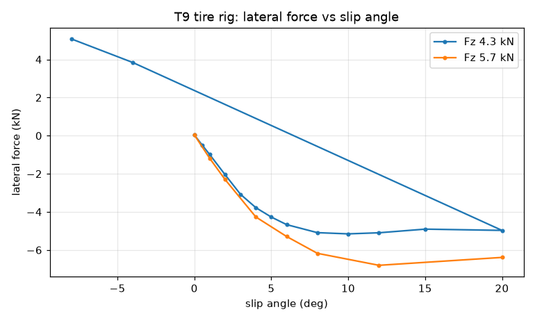

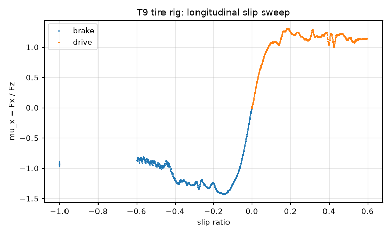

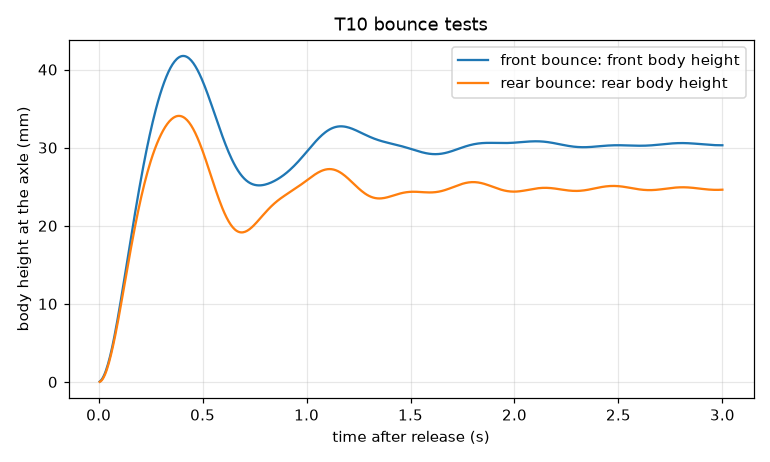

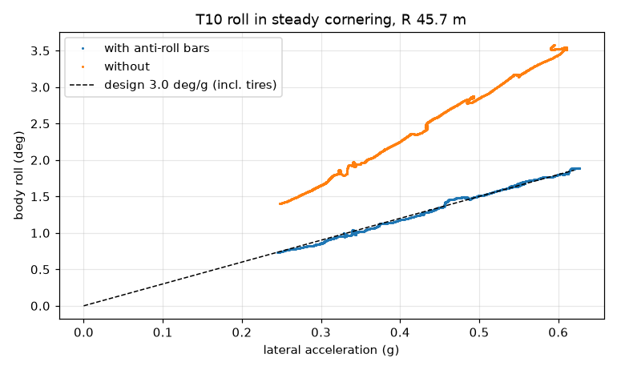

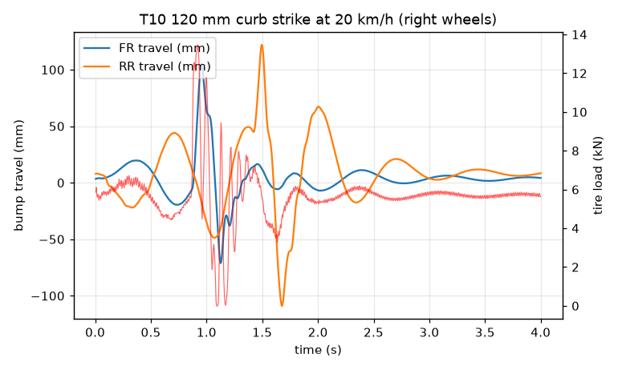

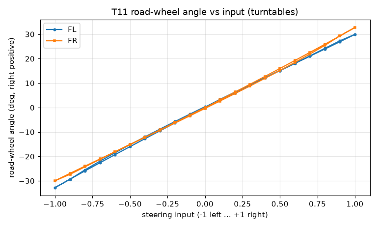

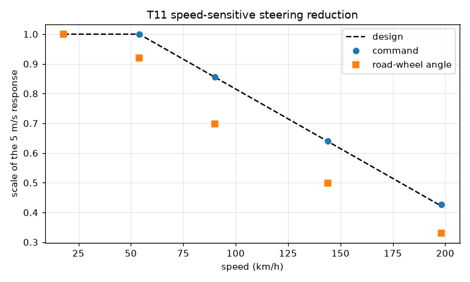

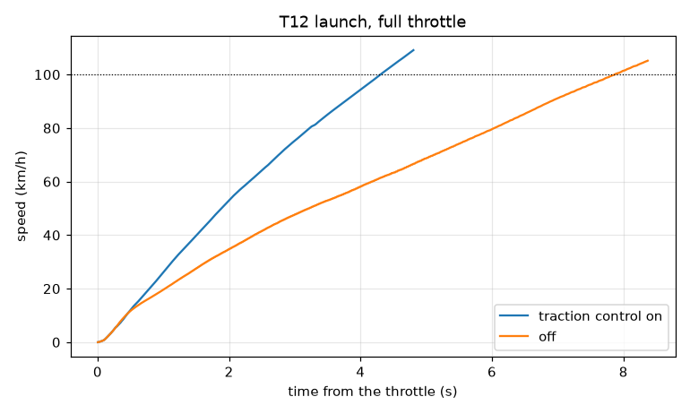

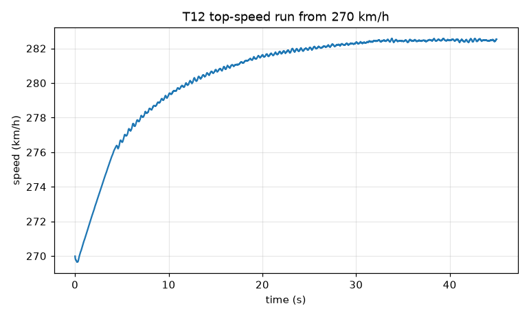

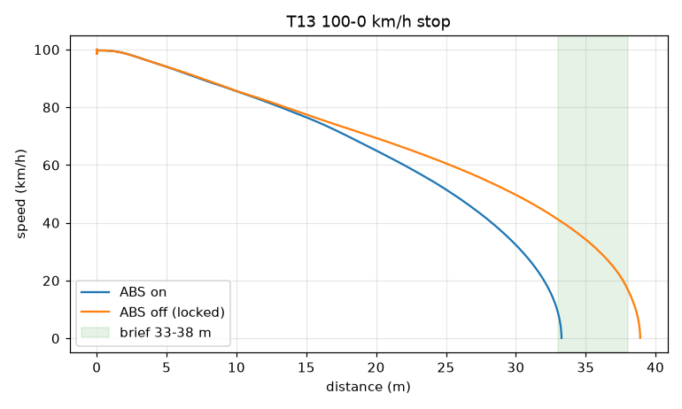

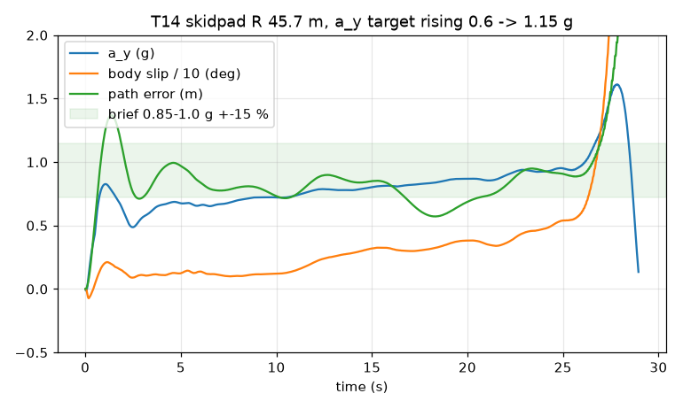

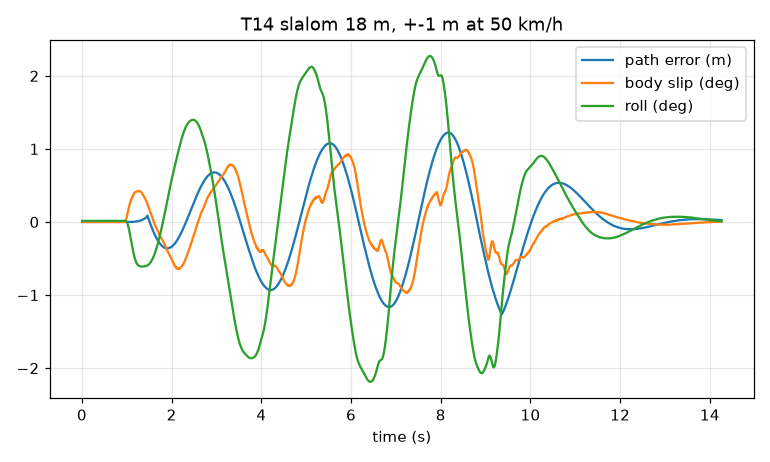

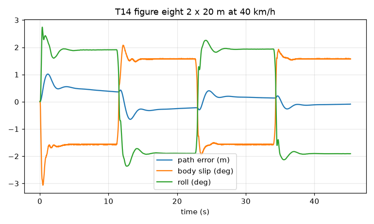

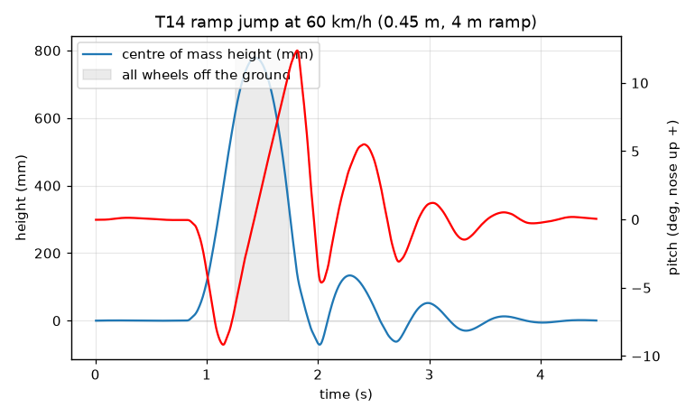

